# 大肥鱼Dock · BigFishDockpro

一款面向 Windows 的桌面整理与美化工具，把常用应用、桌面文件、便签、时钟和日历放在随手可用的位置。

**玻璃质感 · 应用快捷启动 · 桌面分类收纳 · 资源胶囊 · 音乐频谱 · 自定义桌面卡片**

[项目主页](https://github.com/HuoXiaolin/BigFishDockpro) · [版本记录](CHANGELOG.md) · [使用说明](使用说明.md)

## 功能特色

### 资源胶囊：监控、AI、音乐、天气与番茄钟

- 桌面胶囊和任务栏监控可分别开启，独立选择 CPU、GPU、内存、网速、FPS、温度、频率、功耗、电压、水泵和显存等读数。主板、CPU 和 GPU 风扇仅在取得实测转速时显示。
- 今日、本月、本年各有一张流量卡片，分别显示合计、下载与上传。流量页可开启按应用采集，查看实时上下行速度及分时段历史排行。按应用采集需要 Windows ETW 权限，数据从启用时开始记录。历史窗口支持分别重置总流量和应用记录。
- 任务栏支持 2–24 像素字号。缩小后文字、间距和音乐组件同步收紧，空间不足时使用单行或分页。资源读数按上限的 60% / 80% 分别变黄、变红，低于 60% 为绿色，各档色深随读数渐变。
- 任务栏组件可选靠左、居中或靠右，自动避让 Windows 11 的开始菜单、应用按钮和托盘。默认置底，选择置顶可在浏览器或无边框应用全屏时保留已验证的显示位置。任务栏监控与桌面胶囊可分别开启「鼠标穿透」，并从托盘关闭。
- 在「资源胶囊设置 → 胶囊行为」可开启「收起时固定到任务栏」，也可直接把胶囊拖到任务栏。胶囊可在可用空位内拖动、记住位置，点击后向屏幕内展开。胶囊与任务栏监控各自保存位置。
- 横向任务栏可并排显示音乐封面、曲名、上一首/播放暂停/下一首、真实声音律动和进度细线，五类组件可分别勾选，也可只保留频谱或封面图标。音乐与资源文字整体上下居中，默认跟随 Windows 系统配色；可在「任务栏监控」设置或右键菜单开启独立的「文字阈值变色」，按上限的 60% / 80% 将数值变黄、变红，低于 60% 为绿。音乐另有独立「多彩样式」开关，控制频谱与进度线。关闭的组件让出空间，读数按实际宽度紧凑排列；仅在经过检测的任务栏空位显示，空间不足时缩减音乐信息并对读数分页。
- 资源胶囊设置按「胶囊」「监控」「内容与接入」分组。九宫格资源胶囊按钮直接启用或关闭桌面组件。
- 「收起显示」按功能勾选读数。电池、网卡名称、音量、亮度、番茄钟、喝水进度和下一项日程也可加入，读数排序靠前的项目优先保留。「任务栏监控」可单独调整监控列顺序。默认收起 500 × 35、展开 500 × 280，内容始终紧凑。启用自动宽度时，收起宽度按内容缩减。展开宽度为 360 逻辑像素及以下时，页内卡片和读数网格用单列，超过 360 时用双列。正文可用滚轮或触控板上下滚动。可直接拖动桌面胶囊的四边或四角调整大小，收起最小 96 × 28，展开最小 260 × 180。
- 「电脑状态」在同一卡片显示电脑电量、充电状态、网络连接名称、默认输出音量、亮度与外设电量。蓝牙和 2.4G 设备共用外设电量区域，可刷新和翻页。
- 收起时，选中的电脑状态以图标固定在右侧。时钟可只显示日期或时间，也可分两行显示日期和带秒时间。AI 额度使用配额环，音乐显示播放状态与频谱或曲名，天气使用彩色图标和温度，温度分界值可在「资源与阈值」调整。
- 「番茄钟」支持专注、休息和喝水。默认专注 25 分钟、休息 5 分钟。喝水提醒可开关，支持设置间隔、每次饮水量和每日目标，记录后可撤销。胶囊收起后显示倒计时或到点提示，点击提示可打开番茄钟页。
- 「日程」按日期显示会议、待办的截止时间和来源。提醒中的日程排在最前，其次是进行中、未开始和已结束的日程。日程月历与桌面日历共用彩色标记。到点后收起胶囊优先显示提醒，长标题滚完一圈后回到开头停 5 秒。
- 在「日程与提醒 → 日程账号接入」可扫码连接钉钉、飞书和腾讯会议，也可用 API 口令连接滴答清单，或用只读令牌连接 NextTodo 本机版及自建版。Dock 运行期间每 10 分钟同步，改期、取消、完成或删除会更新本机提醒。[接入步骤](docs/资源胶囊与媒体.md#日程账号接入)
- 在「资源胶囊设置 → 胶囊行为 → 展开后默认页面」可选天气等栏目，也可沿用上次查看的页面。胶囊右键菜单有相同入口。所选栏目不可用时打开排序最靠前的栏目。
- 拖动展开页的顶部栏目可排序，拖到胶囊外可分离为桌面卡片，拖组件本体或标题栏回胶囊即可收入。便签、每日图片、原生卡片、时钟与日历也可收入胶囊。「组件布局」仍可统一调整位置与顺序。内嵌时钟和日历共用胶囊材质，独立卡片位置单独保存。
- 胶囊内的卡片按内容使用薄荷青到蓝紫、紫蓝、金橙等渐变，底色适配深浅模式与材质。「材质与配色 → 卡底透底」可调 0%–100%，默认 20%。天气继续沿用晴雨、空气质量及日照时段的配色。
- AI 额度可读取本机已登录的 Claude、Codex、Cursor、Antigravity、ZCode、DeepSeek Harness、Kimi、OpenCode、Pi、Grok Bot，最多同时选择 7 项；展开查看套餐、配额和重置倒计时。同一 AI 页面合并额度与统计，支持今天/昨天/7天/30天/全部、工具筛选（单应用时隐藏）、Token/记录/费用趋势、费用环图、缓存命中率和模型明细。无法读取的账号显示真实状态。左下角仅保留「备注」，点击后查看来源和估算说明。
- 额度卡片以横向进度条显示剩余额度和恢复时间。小时、5 小时、每周和每月额度按服务商返回的数据分别显示。Codex 自动识别 Free、Go、Plus、Pro 100、Pro 200 和 Pro 500，点击重置卡一行可查看各批次到期时间。资源胶囊、桌面卡片和独立 AI 用量窗口共用布局，支持深浅模式。点击托盘图标打开单列 AI 用量窗口，默认 360 × 540 逻辑像素。
- 「AI 与音乐 → 自定义用量接口」可填写常用 API 地址和 Token，自动识别 OpenCode Go、Command Code 及兼容用量接口，也可指定查询地址。接口提供的额度、用量和费用显示在 AI 页。 [接入格式](docs/资源胶囊与媒体.md#自定义用量接口)
- AI 用量托盘图标可独立开关，连续 Q 环显示剩余额度，70% 起为绿色，40% 起为黄色，10% 及以下为红色，其余为橙色；关闭桌面资源胶囊后仍可通过托盘查看额度和统计，无需开启硬件监控。
- 音乐支持 Windows 媒体会话及网易云、QQ 音乐、酷狗的兼容接口。媒体卡片左侧显示封面，右侧显示曲名、频谱、进度和播放控制。支持切换及固定播放器、同步歌词和直播声音暂停。
- 胶囊外圈带连续流动的彩色光环。在「资源胶囊设置 → 材质与配色」可开关光环，选择慢速、中速或快速，默认中速。
- 右键资源胶囊可开关「屏幕边缘吸附」，「表情与吸附」页还可单独开关相邻卡片吸附。贴边后拖动本体会拉出液桥，断开后水滴收回。小表情默认在左侧，可调整样式、大小和互动。开启互动后，圆球、收起和展开状态的小表情都跟随全屏光标。
- 「表情与吸附」与桌面收纳卡片的外观设置均支持「导入角色包」和「复制提示词」。每个角色由透明 SVG 和 `manifest.json` 组成，使用清单中的五官坐标来眨眼、跟随鼠标和切换表情。两处共用角色库，可分别选择角色。[角色包格式](docs/资源胶囊与媒体.md#表情角色包)
- 资源胶囊和桌面收纳卡片可分别启用「定时切换表情」。开启后默认每 10 分钟随机换一次，间隔可设为 1–1440 分钟。
- 「天气与订阅」可开启天气和新闻订阅。当前天气、每日预报、空气质量、日出日落分别配色。日出日落按城市当地时间显示清晨、白天、黄昏和夜间色调。默认显示昨天、今天、明天，可切换七天。空气质量支持 Open-Meteo 自动读取、CAMS 全球小时数据和和风天气。和风天气需要自己的 API Host 和密钥，卡片会标明 AQI 口径。
- 新闻页显示 RSS / Atom 标题、来源和时间，点击整条卡片在浏览器打开。在「天气与订阅」可添加中新网要闻、IT之家和少数派，或编辑自定义链接。勾选列表中的订阅源即可单独开启。

AI 与音乐组件采用流式读取，近期与全部历史共用一个缓存。辅助进程启动后由 Windows 约束总工作集至 47 MiB，托管堆预算为 16 MiB。登录时 Dock 先启动，辅助进程稍后启动，遇到异常会记录日志并重试。[内存测量口径](docs/资源与内存优化验证.md)

流量从启用统计时开始记录，未运行及关闭统计期间不补算；传感器和媒体控制能力取决于设备、驱动及播放器。详细设置见[资源胶囊说明](docs/资源胶囊与媒体.md)。

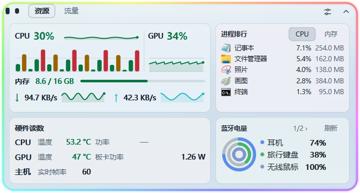

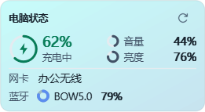

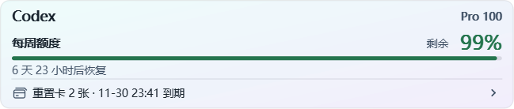

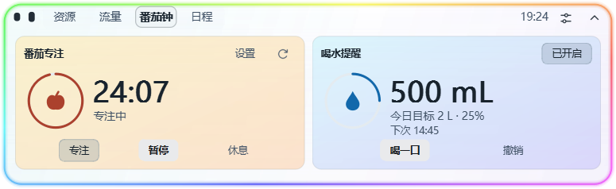

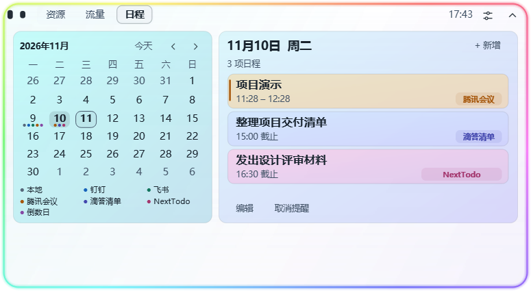

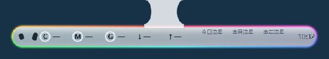

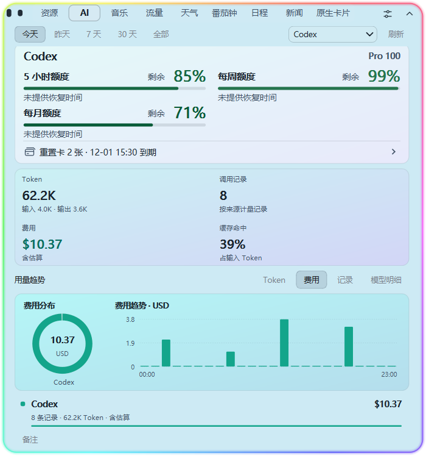

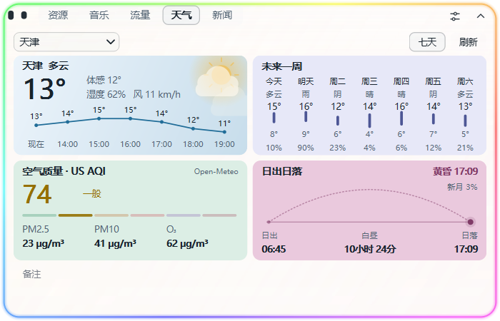

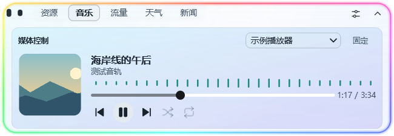

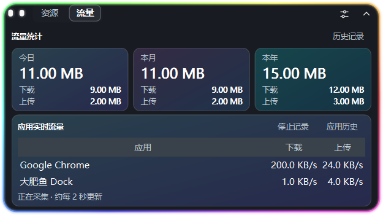

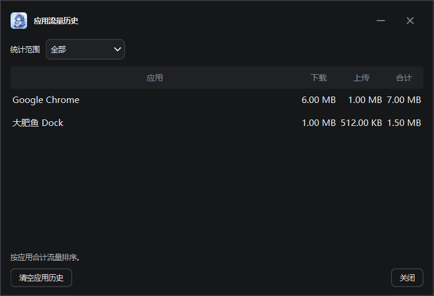

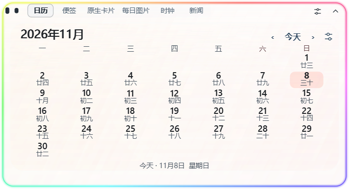

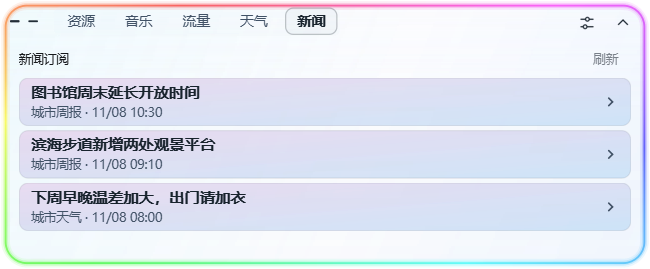

### 桌面组件：音乐频谱、每日图片与自定义卡片

- **音乐频谱**以 120 个真实频段读取系统输出，窄窗口会合并相邻频段。线条、柱形、圆环、镜像和点阵使用透明底，支持炫彩、跟随主题的单色或自选单色。圆环用分离的径向音柱呈现节拍，弱高频也可见，无信号时只留细线。拖左右外沿调直径，拖上下外沿调最高跳幅，拖内圈移动。其他样式可分别拖边调整宽高，拖四角同时调整。各样式均可锁定。
- **每日图片**可查看必应最近最多 8 天的图片。下载原图时可自选保存位置。将必应原图设为壁纸时，图片保存到 Windows「图片」文件夹下的 `BigFishDock\bing-wallpapers`。外框默认跟随应用，可自选材质和颜色。右键可选本地图片或文件夹轮播，间隔 5–3600 秒。
- **原生卡片编辑器**支持配图、字号、配色和排版。可通过开发提示词组合浏览器搜索、番茄钟、维基事件、汇率、本地及在线 JSON 数据和自定义单位换算。[原生卡片配置说明](docs/原生卡片配置.md)

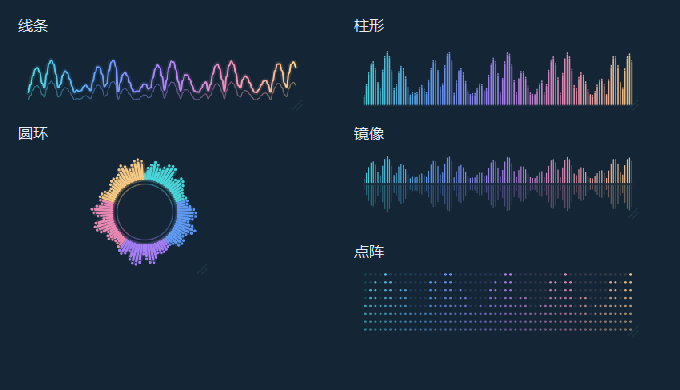

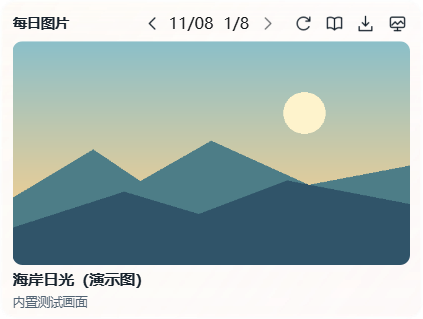

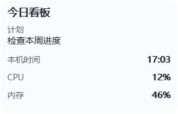

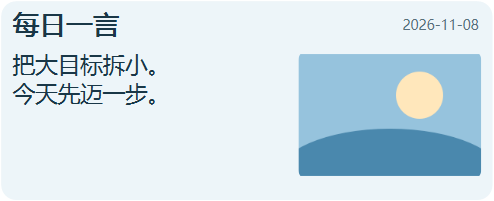

### Dock：常用应用，随手启动

- 支持拖入应用与快捷方式，也可批量添加、批量移除。
- 应用管理支持搜索、多选，区分已固定应用、Windows 工具和正在运行的软件。
- 可修改入口的名称、图标和链接，添加或移除分隔符；图标较多时支持翻页。
- 图标叠放并短暂停留可合并文件夹，支持文件夹命名、搜索、拖入与拖出。
- 提供悬停放大、图标倒影、玻璃材质、外观预设、七种推荐主题色及全透明效果。
- 可显示时间日期，通过可翻页、可排序的九宫格快速切换外观、图标大小及便签/时钟/日历等组件开关，点击＋添加应用；各扩展均可关闭。 [效果与使用说明](docs/Dock快捷设置与倒影.md)
- 快捷设置首页优先显示全部设置、任务栏效果、任务栏文字、应用管理、切换外观和桌面卡片。首次运行的任务栏文字默认跟随系统。
- 右键菜单「任务栏」集中控制效果、文字、Windows 自动隐藏和监控设置。托盘「鼠标穿透」可在全部穿透、全部可交互和自定义之间切换，各组件的自定义选择会保留。

默认液态玻璃以薄荷青 `#64E8DE` 到蓝紫 `#8A64EB` 为强调色。清透水晶采用透亮的冰蓝底和亮边，柔光流彩采用更浓的雾紫底和柔和描边。活力原色、浅色纸玻璃与全透明也有各自的渐变。

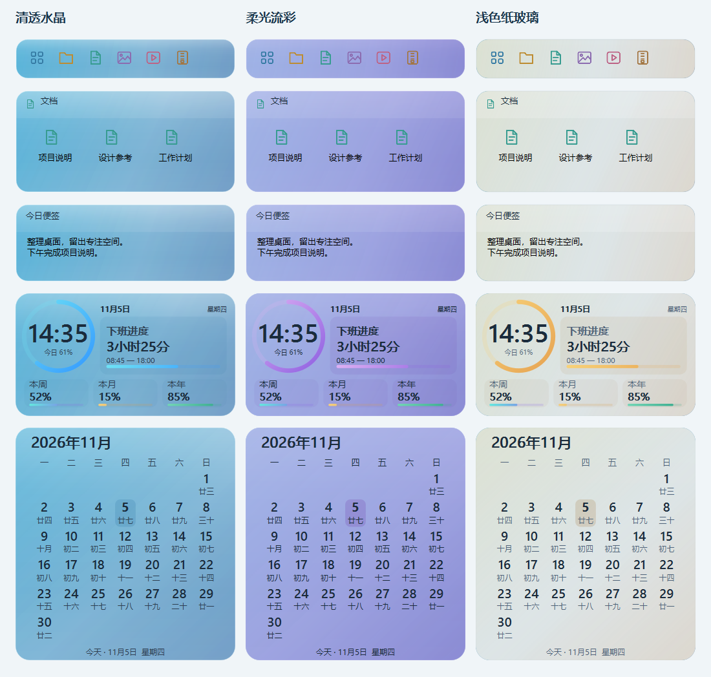

### 桌面收纳：分类清楚，分组合并

- 按应用、文件夹、文档、图片、影音等类型自动分类，也可手动拖入和设置文件格式规则。
- 支持多个独立面板、多个合并组，通过顶部分类栏切换页面。栏目可拖动排序，拖出后独立显示，拖到另一张收纳卡片可合入。拖动独立收纳卡片的标题栏也可合入其他收纳卡片。
- 支持图片缩略图、小图标、大图标和列表视图，以及搜索、文件名或修改时间排序、项目置顶。
- 文件右键调用 Windows 原生菜单，支持复制、剪切、粘贴、删除和重命名等常用操作。
- 收纳保存文件引用，不因收纳或移除引用而搬动、删除原文件；同一文件可被多个面板引用。

### 卡片外观：展开自由，收起轻巧

- 默认采用清透水晶，同时提供柔光流彩、浅色纸玻璃与既有预设，支持整体切换及恢复自定义外观。
- 提供玻璃、浅色渐变、纸卡等外观，支持透明度、模糊、高光、明暗模式和主题色调整。资源胶囊与其他玻璃组件都使用所在屏幕的桌面壁纸。切换壁纸后自动刷新。
- 自由拖动的桌面收纳、便签、时钟、日历和资源胶囊支持屏幕边缘与相邻卡片吸附。可在「设置 → 桌面收纳」开关并调整 2–64 像素距离。
- 桌面收纳面板共用外观设置；独立卡片可自由调整位置与大小，合并页面共用尺寸。
- 启用桌面收纳卡片后默认显示小表情并开启互动。可在标题栏设置或「设置 → 桌面收纳」切换显示、跟随、按压、随机或固定样式及大小。展开、胶囊与圆球都支持鼠标跟随。桌面卡片与资源胶囊的开关分别保存。
- 独立卡片、合并组和便签可分别选择方条、胶囊或圆球收起样式，并支持自动收起、锁定。
- 胶囊和圆球在标题栏水平中心收起，图标居中，悬停显示名称；拖动后仍能恢复展开尺寸。
- 桌面图标可选择同时显示或全部隐藏，支持按屏幕可用区域适配布局。

### 便签与待办：随手记录，自动保存

- 所有便签共用一个窗口。顶部标签切换内容，正文按段落柔和分色，可直接编辑。底色适配便签材质和深浅模式。

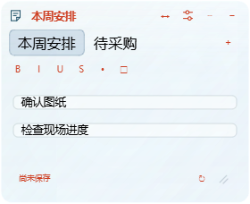

- 提供液态玻璃、经典纸张和极简纯色三种样式，以及多种便签配色。
- 支持双击修改标题、正文独立字号、文字格式、待办清单和搜索。
- 支持新建、隐藏、恢复最近删除及永久删除，内容自动保存到本机。

### 桌面闪念与资源胶囊

- 闪念逐条悬浮在桌面。点开一条可编辑、置顶、设提醒或移到回收站，也可把选中的文字拖到贴边入口。入口支持贴边隐藏，闲置时只留细边、悬停滑出，可独立关闭；拖动可切换左右边缘并记住位置。操作栏按需展开，配色可跟随整体主题，也可选用「活力原色」。
- 桌面资源胶囊可置顶、置底、移动和收起。任务栏双行监控可独立开启，两处共用采样。展开后左侧显示核心负载、显卡、内存和网速，右侧按 CPU 或内存排列进程。背景可跟随整体主题，也可单独设置。支持帧率、温度和功率，两种发行包均内置 PawnIO 离线安装程序。
- 蓝牙和 2.4G 设备共用收起胶囊的外设电量徽标，也可开启一个独立的外设电量托盘图标。每个圆环代表一台设备，低于 15% 变红。
- 在资源胶囊设置「资源与阈值 → 外设电量」可扫描、试读、添加 2.4G 外设并设置别名。华硕天选 P310 可直接试读。电脑状态显示电量及设备回报的充电、休眠状态，收起显示可选外设电量徽标。休眠或暂不可读时标明上次读数。
- 未收录的 2.4G 型号可采集并导出报文样本，也可导出脱敏扫描诊断和 Agent 提示词。配合协议资料或可核对的样本，生成 `peripheral-profiles.json` 后导入、试读并保存。版本 2 配置支持 Feature Report 和设备主动上报的 Input Report。[2.4G 外设适配说明](docs/2.4G外设适配.md)

### 时钟与日历：时间之外，看见进度

- 现代数字显示时分、秒数与 24 格日进度。其他样式包括现代表盘、纵向时间、日历周览、时光进度和月历看板。
- 时钟可独立设置字体、字号、字重、配色、背景、布局与显示内容，并预览效果。自动配色时，时钟和日历深底用白字、浅底用蓝灰字，圆环、进度与今天的标记沿用主题强调色。
- 时光进度可选择主项目与最多四个同排次项目。倒计时可设置到分钟，支持一次、每天、每周、每月或每年。周期进度从上次到期算到下次到期。右键时钟或快捷设置里的「时钟组件」打开编辑。
- 日历周览按天显示农历、节假日与调休，底部显示最近的自定义倒数日。
- 支持工作周、节假日与调休配置，内置 2026 年中国大陆节假日数据，可导入其他年度日历。
- 日历可独立显示为桌面卡片，支持农历、节日名称、已收录年度假期标记、切换月份和回到今天。
- 独立桌面时钟和日历可直接拖动边缘或四角调整尺寸，锁定后固定位置和大小。

### 日常运行：按需开启，记住偏好

- 支持登录时尽早启动、启动路径检测与修复、延迟启动和托盘图标隐藏。任务栏透明在 Windows 任务栏就绪后恢复。
- 「启动与运行」可切换、预览或关闭 Dock 启动动画。默认开启流动描边，也可选滚动文字。
- 「启动与运行」及托盘右键「组件暂停」提供独立的「暂停桌面组件」和「全屏自动暂停」开关。手动暂停会隐藏桌面组件和任务栏监控，全屏自动暂停保留已置顶的任务栏监控。
- 常规运行期间自动释放闲置的桌面收纳窗口和资源页，保留可见界面、页面选择和表情跟随。
- 壁纸共享缓存限制为约 1 MiB，大尺寸毛玻璃保留半尺寸纹理，文字与边框继续原生分辨率绘制。设置只保留正在编辑的页面，切换时保存草稿并释放控件。编辑时资源详情先收起，实时读数和表情继续显示。闲置时释放已关闭设置及可重建缓存；支持的 Windows 版本使用 Segment Heap。
- 隐藏资源页时停止进程排行和逻辑核心查询；重复动画帧复用布局，采样缓冲复用。后台采样线程降低优先级，界面保留用户设置的进程优先级。
- 保存组件显隐、位置和运行偏好，支持配置导入与导出。
- 总设置按「外观与系统」「收纳与组件」「运行与数据」导航。任务栏、桌面组件、胶囊与监控、数据与备份各有独立入口，搜索可定位到对应页。
- 「使用统计」显示今日操作、累计操作、启动次数和运行时长。可查看 7／30／90 天趋势、有操作的天数、每日峰值及功能排行，并可重置本机统计。升级到新版统计时从零开始累计。
- 可启用屏幕圆角美化，Dock、卡片、便签、时钟和日历按需使用。

### 查找与整理：少找一步，安心调整

- 统一搜索已添加的应用、卡片文件、便签与设置；设置页也可直接搜索选项。
- 最近整理可撤销，覆盖 Dock 入口和卡片引用、分组等操作，原文件不受影响。
- 保存多套桌面布局，切换组件位置、尺寸、显隐及分组，保留内容和主题。
- 手动检查失效入口，重新定位或移除引用；网络和可移动位置不误判为失效。

## 效果预览

以下为程序原生界面的演示组合，使用公开应用图标、虚构便签与示例文件。背景、内容和配色用于展示，不包含个人桌面资料。[演示素材来源](docs/demo-assets/README.md)

### Dock：轻透玻璃与全透明

分组分隔、图标倒影与时间显示，让常用应用和快捷操作各就其位。

### 桌面收纳：分类展开，轻巧收起

合并栏目与独立图片面板搭配使用；暂时不用时，收起为胶囊或圆球。

### 便签：三种材质，随手记录

液态玻璃、经典纸张和极简纯色，配合清单与文字格式，记录不同类型的内容。

### 时钟与日历：时间与进度，一眼可见

圆环进度、下班倒计时、数字时钟、表盘和独立月历，按自己的习惯组合。

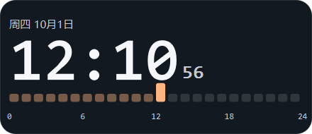

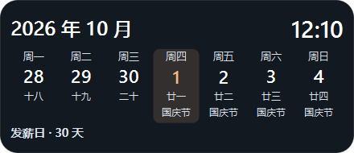

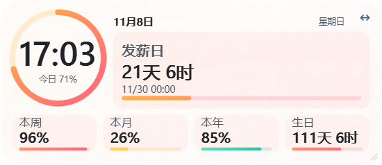

### 应用管理：常用入口，集中整理

搜索、多选与批量添加，分别管理已固定应用、Windows 工具和正在运行的软件。

## 支持与赞助

感谢您使用 **大肥鱼Dock**！如果它让您的桌面更整洁、日常使用更顺手，欢迎随心赞助，请作者喝杯咖啡。

您的支持将用于持续维护、功能完善，以及补贴开发过程中的 **AI Token 和工具开销**，也是继续更新的一份动力。赞助完全自愿，欢迎同样通过问题反馈、功能建议或分享项目支持开发。

| 支付宝 | 微信支付 |
| :---: | :---: |
|  |  |

## 开始使用

首次启动会载入默认设置，包括 Dock、时钟、任务栏和资源胶囊的外观与功能偏好。资源胶囊和桌面卡片的表情显示与互动默认开启。桌面卡片、任务栏监控、AI 用量托盘图标和闪念胶囊的组件开关默认关闭。升级或导入旧配置时，缺少的功能选项按内置默认设置补齐，已有设置优先。也可在「设置 → Dock 外观 → 使用默认设置」载入预设，再点「保存设置」应用。应用入口、收纳文件、便签和闪念内容按本机配置管理。

支持 **Windows 10 / 11 x64**，无需另行安装 Python。

AI／音乐组件复用本机的 **.NET 10 Desktop Runtime（x64）**。首次启用相关功能时，应用检测缺失的 .NET 10 或 PawnIO，分别弹出一次安装提示。可从提示下载微软安装程序或启动内置 PawnIO 安装包。跳过后，可在「资源胶囊设置」中打开相同入口。 [微软 .NET 10 下载](https://dotnet.microsoft.com/en-us/download/dotnet/10.0)

- **免安装版**：运行 `BigFishDockpro.exe`。
- **安装版**：运行 `BigFishDockpro-Setup-x64.exe`，按提示完成安装。
- 首次运行默认开启 Dock、桌面收纳和屏幕圆角。收纳分类合并成一张卡片，并以圆球收起。右键 Dock 可进入设置和应用批量管理。
- Windows 11 x64 的任务栏特效可从单文件版「设置 → 任务栏」离线安装，也可在完整安装包中勾选安装。Windows 10 使用内置后端。
- 可在设置或对应菜单中开启便签、时钟和日历。
- 个人配置保存在 `%APPDATA%/BigFishDock`；更换电脑或备份前，可在设置中导出配置。导出文件可能包含个人路径和便签内容，请妥善保管。

## 更多说明

[桌面收纳](docs/桌面收纳面板.md) · [便签卡片](docs/便签卡片.md) · [时钟与工作进度](docs/时钟设计与工作进度.md) · [尺寸与显示适配](docs/卡片尺寸与界面适配.md) · [运行与更新](docs/运行模式与更新.md) · [查找整理与三套主题](docs/查找整理与主题.md)

开发与构建请参阅 [项目说明](docs/项目说明.md) 和 [源码结构](docs/源码结构.md)；历史改动见 [更新日志](CHANGELOG.md) 与 [历史记录](CHANGELOG_HISTORY.md)。

本轮运行内存优化的测试口径、样本和边界见[资源与内存优化验证](docs/资源与内存优化验证.md)。

## 开源致谢与许可

大肥鱼Dock 的项目源码采用 [GNU GPL 第 3 版（GPL-3.0-only）](LICENSE)。原 iOS-style-Dock 代码的 [MIT 版权与许可声明](licenses/iOS-style-Dock-MIT.txt) 随项目保留。

感谢以下项目提供实现与设计参考。相关许可及版权声明见 [第三方说明](licenses/THIRD-PARTY-NOTICES.md) 和 [设计参考](docs/design-references.md)。

| 项目 | 本项目中的用途 | 来源与许可 |
| --- | --- | --- |
| iOS-style-Dock | Dock 代码与交互 | [WKaleXD/iOS-style-Dock](https://github.com/WKaleXD/iOS-style-Dock)，MIT |
| FullWidget | 天气、媒体、内容卡片与可编辑组件设计 | [hmgvibe/FullWidget](https://github.com/hmgvibe/FullWidget) |
| BrimDeck | 收起胶囊交互参考；复用 AI 配额/用量与音乐数据连接代码。本应用使用自己的 Qt 界面、主题和材质 | [MoFeng2223/BrimDeck](https://github.com/MoFeng2223/BrimDeck)，[中文说明](https://github.com/MoFeng2223/BrimDeck/blob/main/README.zh-CN.md)，Apache-2.0 |
| OpenQuota | AI 用量筛选、费用分布、趋势图及分段额度托盘图标的设计参考；以原生 Qt 实现，不捆绑其运行时 | [deviffyy/OpenQuota](https://github.com/deviffyy/OpenQuota)，[固定版本](references/OpenQuota-PIN.json)，[MIT](licenses/OpenQuota-MIT.txt) |
| LobeHub Icons | 收起胶囊的供应商图标素材 | [lobehub/lobe-icons](https://github.com/lobehub/lobe-icons/tree/989535d6c13da2dec5a2937fe2789d4af4fdd8e0)，[MIT 与素材来源](licenses/LobeHub-Icons-MIT.txt) |
| Wisland | 将液态形状、弹簧与表情代码适配到 PyQt5 | [AsamiAkito/wisland](https://github.com/AsamiAkito/wisland)，[固定版本](references/Wisland-PIN.json)，[MIT](licenses/Wisland-MIT.txt) |
| Uiverse · SelfMadeSystem | Dock 启动动画的流动描边参考 | [You.com Animated](https://uiverse.io/SelfMadeSystem/pretty-treefrog-77) |
| Freesound | 六段自然提醒音的录音来源 | [录音及 CC0 许可](licenses/THIRD-PARTY-NOTICES.md#natural-reminder-sounds) |
| BlueGauge | 蓝牙设备电量与独立托盘显示的功能参考 | [iKineticate/BlueGauge](https://github.com/iKineticate/BlueGauge)；本应用使用自己的设备读取与环形绘制 |
| HaloBattery、ChargeDock | 2.4G 外设电量协议及接收器兼容信息参考 | [HaloBattery](https://github.com/HeyOkay/HaloBattery) · [ChargeDock](https://github.com/SgZincanya/ChargeDock) |
| LiteMonitor | 硬件读数与任务栏监控的功能参考 | [Diorser/LiteMonitor](https://github.com/Diorser/LiteMonitor)；本应用保留自己的监控架构 |
| PresentMon | 读取应用实际呈现帧，计算 FPS | [Intel PresentMon](https://github.com/GameTechDev/PresentMon)，[许可](licenses/PresentMon-LICENSE.txt) |
| PawnIO / PawnIO Modules | 支持的 CPU 温度与封装功率读取 | [PawnIO](https://github.com/namazso/PawnIO)，[模块](https://github.com/namazso/PawnIO.Modules)，[本地许可与说明](licenses/PawnIO-Modules-NOTICE.txt) |
| TranslucentTB | Windows 11 任务栏外观后端 | [TranslucentTB](https://github.com/TranslucentTB/TranslucentTB)，[许可](licenses/TranslucentTB-LICENSE.txt) |

BrimDeck 参考源码固定在提交 `5cbf5596a4163803d2411b96b37f16d925a11986`；原始版权及[许可](licenses/BrimDeck-Apache-2.0.txt)、[第三方声明](licenses/BrimDeck-ThirdPartyNotices.txt)一并保留。适配入口为 `tools/DeckBridge`，参考源码位于 `references/BrimDeck`。构建和数据边界见[资源胶囊说明](docs/资源胶囊与媒体.md)。
