# 大肥鱼Dock · BigFishDockpro

右键卡片中的文件或文件夹可打开 Windows 系统文件菜单；置顶、引用到其他面板和移除收纳引用放在“大肥鱼Dock”子菜单。Windows 11 可能以经典菜单样式显示。

桌面收纳卡片支持多选后使用 Ctrl+C 复制、Ctrl+X 剪切；Ctrl+V 或右键“粘贴到桌面”由 Windows 将文件放入桌面文件夹。右键文件夹还可粘贴到该文件夹，重名时保留原文件并生成新名称。卡片的“移除收纳引用”不会删除原文件；虚拟附件请先保存为文件。

桌面时钟可在“设置 → 桌面收纳”或托盘、Dock 右键菜单开启；提供现代数字、现代表盘、纵向时间、日历周览、时光进度与月历看板样式，支持拖动和调整大小；时钟设置中可独立调整字体、文字颜色、通透玻璃或清晰效果、背景材质与主题色，并实时预览。右键时钟可打开设置、切换样式、锁定位置与大小或隐藏。时钟按分钟刷新，隐藏时停止更新。

已移除实时玻璃背景及独立合成窗口，所有组件使用原有稳定的玻璃渲染；透明度、材质、主题色和模糊强度仍可调整。

## 项目介绍

**大肥鱼Dock（BigFishDockpro）** 是一款面向 Windows 的桌面整理与美化工具，将常用应用启动、桌面文件收纳和玻璃外观设置集中在一起，适合希望桌面整洁、常用入口随手可用的用户。

软件包含三个独立部分：**Dock** 用于固定和启动常用应用，支持桌面快捷方式拖入、批量添加与移除、名称及图标修改；**桌面玻璃面板** 用于收纳文件、文件夹与快捷方式，可按类型自动分类，也可手动拖入多个面板。收纳只保存原文件引用，不移动或删除文件；启用面板时临时隐藏原桌面图标，关闭后恢复。

Dock 与面板提供液态玻璃等材质、明暗模式、七种推荐主题色及全透明预设。每个面板可单独调整外观、位置和大小，按内容紧凑排列，并收起为方条或胶囊；屏幕圆角、游戏模式、自启动路径检测与修复、自动精简模式则用于适配日常运行。

本项目以 [WKaleXD/iOS-style-Dock](https://github.com/WKaleXD/iOS-style-Dock) 为基础，保留原有玻璃效果、鱼眼动画和托盘控制，逐步补充桌面收纳与应用管理功能。

支持 Windows 10/11 x64；安装包自带所需 Python/Qt 运行文件，使用者无需安装 Python。当前版本以 `version.json` 为准。

## 效果截图

以下展示程序真实控件在隔离桌面中的截图与渲染预览，均使用演示内容；透明玻璃效果会随实际桌面背景变化。

### Dock 外观

以下三张由实际 Dock 控件渲染，使用 8 个自绘测试图标与演示背景，不读取个人应用列表。

**浅色玻璃**：常用入口集中排列。


**深色玻璃与悬停放大**：展示鱼眼放大、表面起伏和应用名称提示。

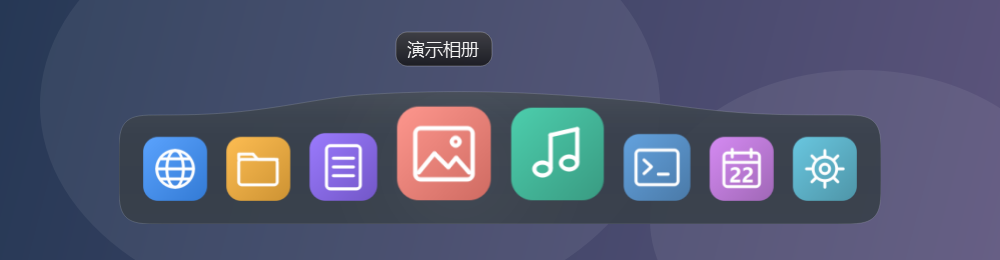

**全透明预设**：隐藏玻璃底板，保留图标。


### 桌面收纳与紧凑布局

多个面板独立收纳桌面内容，支持手动调整大小、默认分组开关、自定义格式规则，以及选择部分卡片合并后通过顶部栏目切换，其余独立显示。少量图标时自动缩短高度，减少空白。

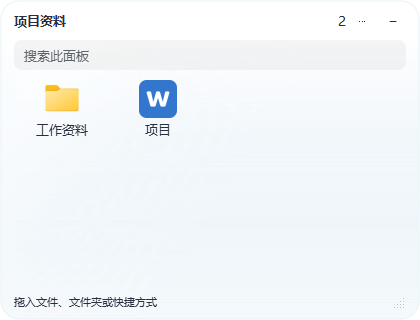

紧凑面板的浅色与深色外观：

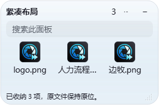
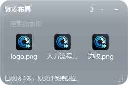

### 胶囊与方条收起


### 设置与应用批量管理

统一的设置页面，以及支持搜索、多选和图标显示的应用批量管理列表。

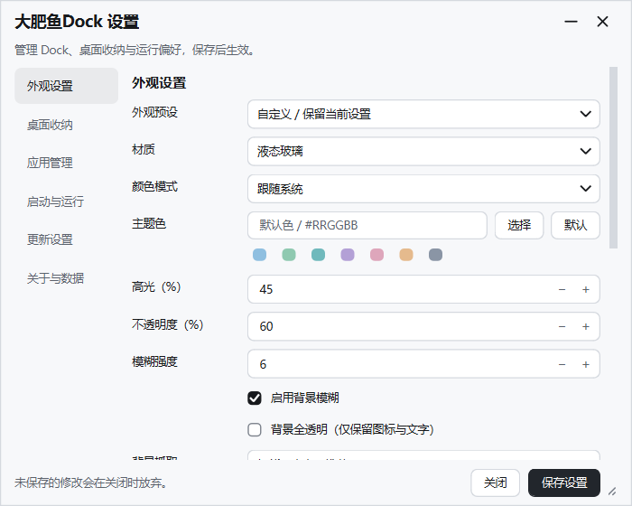
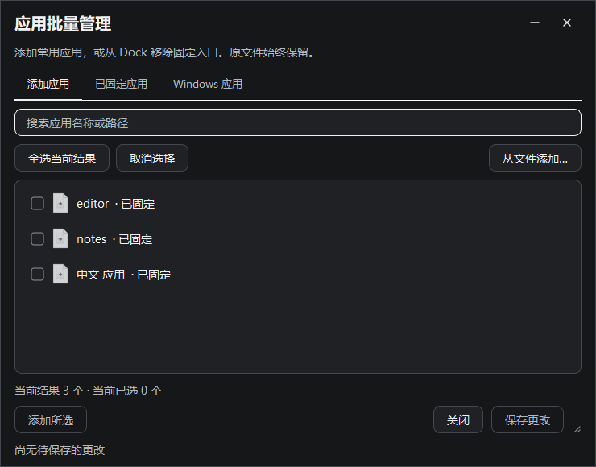

“正在运行”栏目与配置导入导出（使用演示应用和测试数据）：

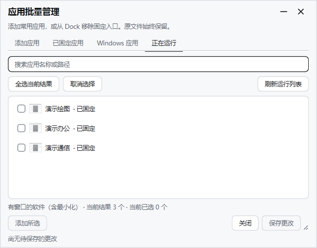
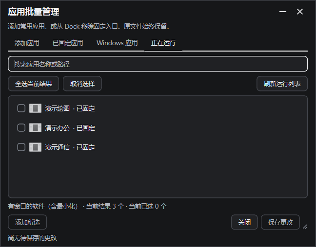
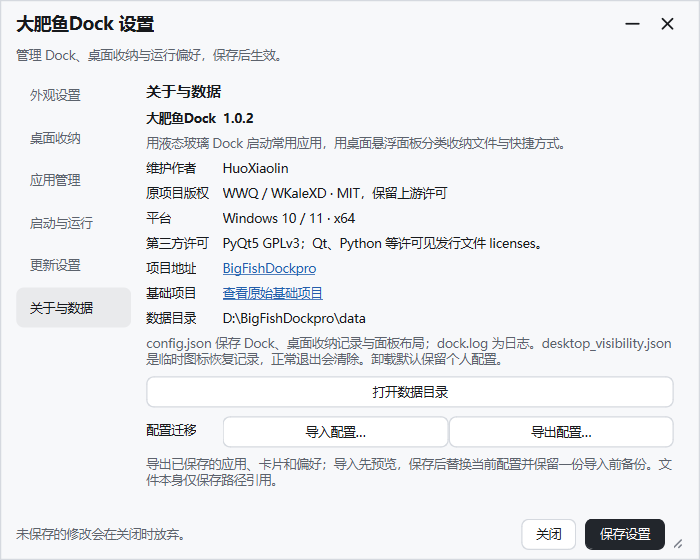

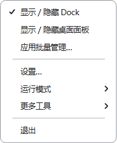

### 材质对比、分组与显示方式

同一演示背景下的六种材质实际绘制对比（云母为软件模拟）：

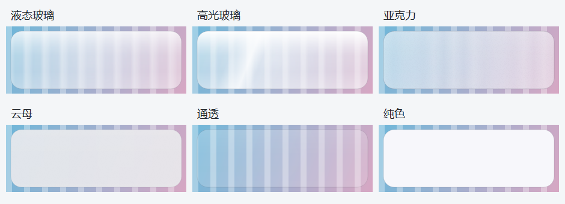
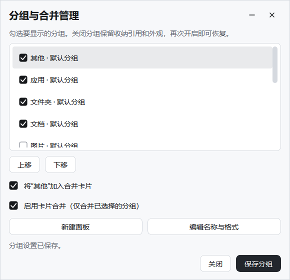
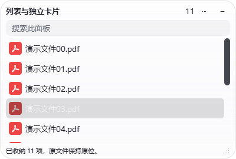

## 使用

首次运行默认显示 Dock，桌面卡片关闭。将应用或快捷方式拖入 Dock，或右键打开应用批量管理、设置；需要桌面收纳时在设置中启用。已有配置继续按保存的状态恢复。

- 托盘右键 → **应用批量管理**。“添加应用”可扫描开始菜单、桌面和 Windows 应用，也可从文件多选；“已固定应用”支持批量移除。
- 支持名称/路径搜索、全选当前结果、取消选择。筛选外勾选会保留并显示数量，但不会被当前“添加所选 / 移除所选”操作影响。
- 添加或移除先进入待保存状态，点击 **保存更改** 才会生效。**取消**、Esc 或关闭窗口放弃尚未保存的改动。移除只解除 Dock 入口，原文件不删除、软件不卸载。
- 将桌面的一个或多个应用快捷方式拖到 Dock 即可加入；保存引用，保留快捷方式参数、工作目录及原文件。相同路径自动跳过，不同路径快捷方式保留独立入口。
- 启用桌面面板后，桌面内容按类型自动收纳到多个悬浮面板，桌面图标可选择同时显示或全部隐藏；文件不移动、不修改隐藏属性。面板默认按内容紧凑排列，减少底部留白；标题处拖动，右下角缩放，点击“⋯”设置各面板的外观、锁定与收起形状。
- 托盘 → **设置**，按 外观设置、桌面收纳、应用管理、启动与运行、更新设置、关于与数据分组。关闭面板或退出软件会恢复原桌面图标显示状态。

Windows 的“此电脑”“回收站”等虚拟系统图标不属于本地文件拖放，本次不支持。请普通用户运行，避免高权限窗口阻止桌面拖放。固定图标过多时，Dock 可用滚轮翻页。

## 新增外观与运行功能

- **桌面玻璃面板**：独立于 Dock 的常驻收纳窗口，默认复用 Dock 液态玻璃；可逐个设置透明度、模糊、高光、材质、锁定及布局。自动收起为方条或胶囊，点击或悬停展开。
- **外观预设与主题色**：Dock 在设置页选轻透、柔雾、高光、深色或全透明预设并自定义主题色；每个面板在“⋯ → 外观与收起”选择五套预设（含全透明）、独立明暗与主题色。预设应用后仍可微调，不改变位置、尺寸或内容。
- **分组与视图**：在“桌面收纳 → 分组与合并管理”开启或关闭默认分组，选择各分组是否参与合并，合并卡片通过顶部栏目切换，其余卡片独立显示。卡片右键可切换小图标、大图标和列表，分别记住选择。
- **自定义格式**：新建面板填写 `.pdf .docx .png` 等扩展名，或在面板菜单编辑规则；同一文件可出现在多个面板，单个面板的移除不会影响其他引用。
- **桌面收纳**：按应用、文件夹、文档、图片、影音、压缩包、其他内容自动分类；目录变化后更新，支持搜索、多选、手动拖入和跨面板调整。移除只解除引用，保留文件。Dock 的批量管理与分页独立保留。
- **屏幕圆角**：启用后在桌面、普通窗口和普通全屏应用中持续显示鼠标穿透的屏幕角遮罩，半径可调；仅手动游戏模式隐藏，精简模式仍保留。
- **精简运行**：默认启用，关闭设置 1 分钟后暂停模糊抓取、运行扫描、位置/全屏轮询，面板收为方条或胶囊；目录通知继续分类。展开面板或打开设置恢复完整模式。基础 Dock、托盘和静态圆角继续工作。
- **运行方式**：用户级自启动、恢复上次显示与运行状态、托盘隐藏、0–300 秒延迟、进程优先级；手动游戏模式和前台全屏自动检测。
- **更新检查**：启动检查、系统/环境代理或直连。本项目暂未提供更新源，设置页可配置 HTTPS 清单；不会替换成上游版本，也不会静默安装。

[桌面面板使用说明](docs/桌面收纳面板.md) · [运行模式、边界与更新源协议](docs/运行模式与更新.md)。

## 获取和构建

本地开发目录为 `D:\Agant\BigFishDockpro`，项目标识为 `BigFishDockpro`；精简源码和正式发行分别同步到 `Github_Source/BigFishDockpro`、`Github_Releases/BigFishDockpro`。发行目录平铺保留安装包 `BigFishDockpro-Setup-x64.exe`、免安装单文件 `BigFishDockpro.exe` 与 `SHA256SUMS.txt`，不重复生成 ZIP 或源码压缩包。

单文件版只需复制一个 EXE，双击即可运行，无需 Python 或旁边的 DLL 文件。运行时会把必需库临时解包到 Windows 临时目录，启动可能略慢；配置仍保存在 `%APPDATA%/BigFishDock`，与安装版共用，不同时运行两种版本。

```powershell
./bootstrap.ps1 -Toolchain D:\Agant\toolchain
./build.ps1 -Toolchain D:\Agant\toolchain -Deliver
```

工具默认使用共享目录的 `python_3.12.14/python.exe` 和 `inno_setup/ISCC.exe`；`.venv` 只放本项目依赖。允许参数指定其他工具链根目录或 `-Iscc`，不修改全局 PATH。源码不携带 SDK、工具二进制、构建缓存或真实运行配置。详细目录映射、验证入口和版本规则见 [项目说明](docs/项目说明.md)。

## 数据、来源和范围

配置和日志沿用 `%APPDATA%/BigFishDock`，可在设置中查看并打开。安装/卸载默认保留个人数据，重置前先退出。应用扫描不上传列表；只有启用检查更新且填写本项目更新源后，才会向该地址联网检查。

维护作者：HuoXiaolin；基础项目版权与 MIT 许可保留在 [LICENSE](LICENSE)。随 GPL PyQt5 分发的组合二进制遵循 GPLv3；完整应用源码及第三方许可随精简源码目录交付，参见 [第三方说明](licenses/THIRD-PARTY-NOTICES.md)。未复制 GlassDesk 或 GlassBoard 的代码或资源。

[版本迭代清单](docs/版本迭代清单.md) · [最新更新](CHANGELOG.md) · [历史更新](CHANGELOG_HISTORY.md) · [GlassBoard 视频功能清单](docs/Glassboard功能清单.md) · [界面与验证](docs/界面与验证.md)

项目地址：[HuoXiaolin/BigFishDockpro](https://github.com/HuoXiaolin/BigFishDockpro)。原始基础项目链接单独保留，不作为本项目更新源。


列表视图逐行显示全部文件，内容超出卡片高度时滚动浏览。设置中的面板启用开关保存后生效；临时显示或隐藏使用 Dock / 托盘菜单，不再保留重复的“显示桌面面板”按钮。


分组栏目支持拖动排序，调整后自动保存；也可在“分组与合并管理”选中一行，点击“上移 / 下移”，最后保存分组。关闭管理页会放弃未保存的排序。栏目顺序不改变文件分类，卡片内文件仍可在右键“排序方式”中按文件名或修改时间排列。


分辨率变化或更换显示器时，Dock 和卡片按屏幕可用区域保持相对位置；卡片宽高按同一比例调整，Dock 图标与边距同步调整。布局以原始屏幕为参照，临时缩屏或断开显示器不会覆盖原参照；原屏恢复后可恢复布局。手动移动、调整卡片大小会建立新的参照。合并卡片与独立卡片分别记录，收起形状和分组顺序继续保留。不同长宽比和极小工作区会限制到可见区域，并保留最小可操作尺寸；所有卡片统一展开宽高，内容超出时滚动。系统 DPI 由 Qt 处理，不重复缩放。旧配置首次升级时以当前屏幕建立参照，无法推算升级前未记录的显示器信息。


1.0.2 修复混合 DPI 换屏：卡片外框缩放时，内部字体、图标、按钮和间距一起调整。例如同为 2K，外接屏 100% 切到笔记本 150% 时，不再只缩小外框而保留大字号。手动移动会保留当前视觉比例；重复换屏和重启不继续放大。原布局及分组排序保留，无需清空个人配置。设置及外观弹窗使用独立的常规界面字号。


应用批量管理新增“正在运行”：进入后读取当前桌面有窗口的软件，最小化窗口也包含；可点击“刷新运行列表”，搜索、多选后点击“添加所选”，再“保存更改”固定到 Dock。已固定的相同启动入口会标记并禁用重复添加；同一程序多个窗口只显示一项。只添加程序启动入口，不附带当前文档、窗口内容或进程参数。后台服务、隐藏宿主和无法读取的受保护进程不列出。关闭页面取消未保存改动并释放运行列表。


在“设置 → 关于与数据”可导入或导出 JSON 配置。导出包含已保存的 Dock 应用、桌面收纳引用、分组、外观、布局与运行偏好，不包含应用、原文件、自定义图标图片或日志本身；未保存的设置不导出。导入先预览，点击“保存设置”后替换，关闭则放弃；保存前在数据目录保留 config.before-import.json，可重新导入恢复。恢复该备份时保留原备份并另存一份 config.before-restore.json。导入格式或保存 / 应用失败时不会直接丢弃原配置。换电脑后，本地路径不同的应用、文件和图标需要重新选择。兼容本项目原始 config.json 及带项目标识的导出文件。


设置窗口右上角提供自动适配、小、中、大和手动调整。三档同步改变字号、控件与间距，高分辨率可自动放大；手动拖动后记住尺寸，点击保存设置后恢复该选择。右键菜单继续保持紧凑。桌面卡片与便签共用字号；独立卡片可拖动改变宽高，合并页面共用宽高。


## 桌面显示与便签卡片

在 **设置 → 桌面收纳 → 桌面图标显示** 选择：

- **桌面与卡片同时显示**：保留桌面图标，可直接拖入卡片，保存引用并保留原文件。
- **隐藏全部桌面图标**：沿用原有行为。旧配置继续使用这一模式。

旧版本留下的 `desktop_items_visibility.json` 用于安全恢复由软件设置过隐藏属性的桌面项目；无法恢复时保留记录并提示，不要手工删除记录代替恢复。桌面目录除系统通知外，每 15 秒补查一次，改善远程复制漏通知的情况。

**便签入口**：Dock 右键 → 便签卡片，或托盘“更多工具 → 便签卡片”；也可从设置的桌面收纳页新建和管理。每张便签菜单可选择液态玻璃、经典纸张、极简纯色，以及七种配色；可移动、调整大小、置顶、锁定位置和收起。

支持标题、正文、加粗/斜体/下划线/删除线、项目符号、可点击待办方框、600 ms 自动保存、即时重试、搜索、隐藏及恢复最近删除的 32 张便签。保留最多 64 张，单张正文最多 32000 字符，便签与最近删除总内容限制为 4 MiB。内容保存在本机，不含账号或云端同步；粘贴使用纯文字，便签不读取外部图片资源。配置导入导出包含便签正文，请妥善保管导出文件。保存失败不清空当前编辑内容，退出保存失败时写入 `notes-recovery.json` 恢复备份；恢复备份成功后清除该记录。

游戏/前台全屏隐藏与原运行模式保持一致，精简模式停止便签背景抓取，保留文字编辑和自动保存；换屏按记录的参考工作区恢复比例，不重复缩放。

本批修复外部应用继承单文件临时运行库路径的问题：启动程序、链接和目录时使用独立运行环境并在调用后恢复 Dock 自身状态，避免外部进程继续占用临时运行库。隔离测试会在外部原生程序仍运行时让单文件真正退出，并检查本次解包目录消失，具体边界见验收记录。


[便签卡片详细说明](docs/便签卡片.md)。


三种便签样式（实际界面，演示文字）：

| 液态玻璃 | 经典纸张 | 极简纯色 |
| --- | --- | --- |
| 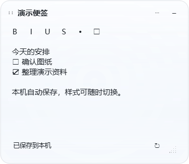 | 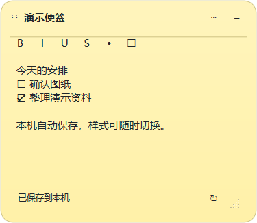 | 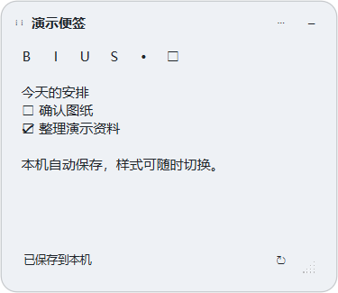 |


## 卡片与设置窗口大小（1.0.3）

- **卡片尺寸与文字**：设置“桌面收纳 → 卡片缩放 → 尺寸与文字”，或卡片/便签菜单“尺寸与文字”。字号应用到所有现有和新建卡片；宽高仅设置新卡片默认值。已有独立卡片可拖动右下角调整，合并页面共用宽高，改字号不重置已有尺寸。
- **整体比例**：桌面收纳中的“卡片整体缩放”作用于桌面卡片和便签，默认70%，可改50%–150%；手动输入的尺寸和文字记录自己的参照，后续换屏和比例切换不累计放大。新建卡片在高分辨率下按可用区域获得更合适的初始大小。
- **设置窗口**：右上角“窗口大小”可选自动适配、小（560×448）、中（800×640）、大（1200×960），宽高为Windows缩放后的界面尺寸；当前屏幕容纳不下时限制在可用区域。字体、控件、色块和间距随档位同步。拖动右下角改为手动调整，保存后记住当前尺寸与文字档位。
- 自动档按当前可用界面区域选择：至少3000宽或1700高时使用大档；至少1550×850使用中档，其余使用小档。Windows本身的缩放由Qt处理，不额外乘一次系统DPI。

尺寸和文字偏好包含在配置导入导出中；便签正文与文件引用不因改尺寸而改变。已保存的大屏参照不会被自动换屏投影覆盖，返回原显示器时按原参照恢复；极小工作区受最小可操作尺寸约束。


[卡片尺寸与界面适配详细说明](docs/卡片尺寸与界面适配.md)。


设置三档与卡片尺寸调整（私有测试界面，演示数据）：

| 小档 | 中档 | 大档（4K工作区模拟） |
| --- | --- | --- |
| 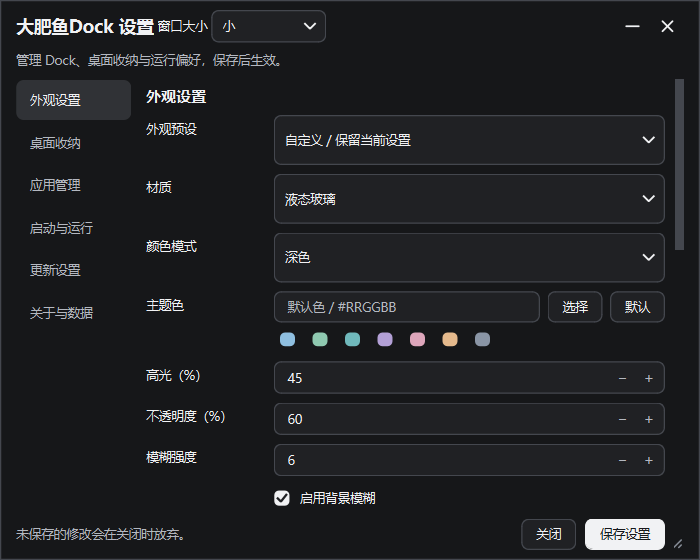 | 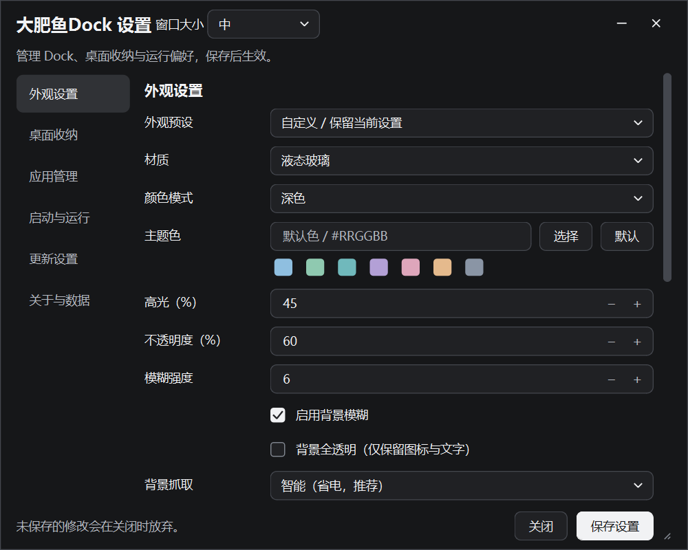 | 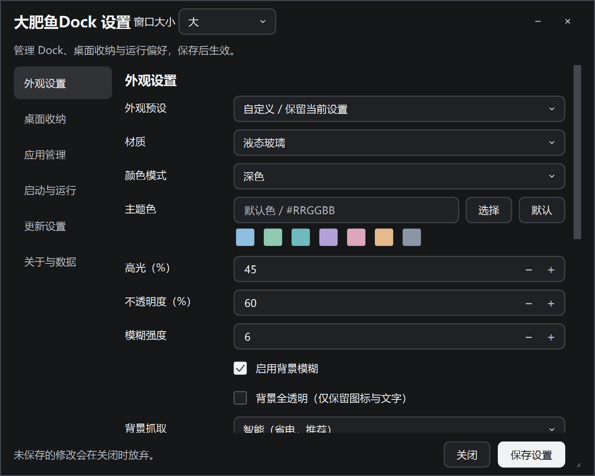 |


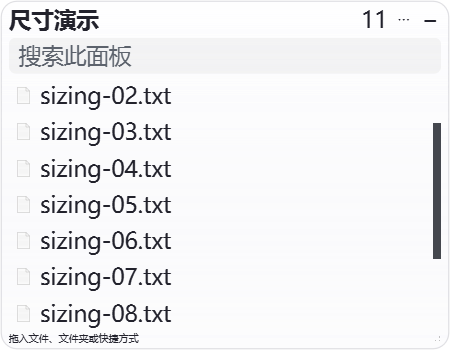
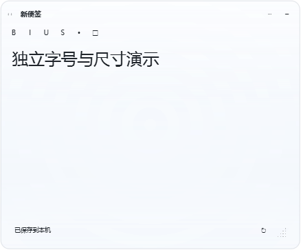

当前1.0.3同日修订：卡片尺寸与文字统一设置；本次按用户要求跳过所有功能、启动及回归测试，仅构建和同步本地发行包。旧截图为样式参考，历史测试通过记录不代表本次构建已测试。


### 1.0.3 同日修订（本次按要求未测试）

- 字号应用到全部卡片和便签，独立卡片各自记住拖动调整的宽高，合并页面共用宽高。设置与菜单使用“尺寸与文字”，宽高字段作为新卡片默认值。
- 设置页的面板、便签、更新操作按用途横向排列；尺寸入口与缩放控件同排，数据目录旁直接打开，精简重复说明。
- 便签菜单与管理页提供“永久删除”，最近删除中的便签同样可彻底移除。确认后删除，取消或保存失败保留原内容；不清理已导出的配置和其他备份。
- 桌面卡片标题增加分类图标、数量标记及紧凑按钮，分组栏区分悬停、按下和选中，保留拖动排序。
- 托盘与Dock右键按应用、Dock布局、桌面卡片、便签、运行模式、设置、帮助与更新分组。分隔符可在Dock布局中添加、按两侧应用定位移除或移除全部；也可右键分隔线移除当前项。

本次使用跳过测试的构建方式，仅生成并同步本地单文件、安装包与精简源码，没有运行功能、启动、回归、退出或视觉测试，没有线上发布。前面的功能说明与截图中如有差异，以本节为准。

## 支持与赞助

感谢您使用 **大肥鱼Dock**！如果这个小工具让您的桌面更整洁、使用更顺手，欢迎随心赞助，请作者喝杯咖啡。

您的支持将用于项目的持续维护与功能完善，也能补贴开发过程中 **AI Token 等工具开销**，为后续更新添一份动力。每一份支持、建议与问题反馈，都十分珍贵。谢谢！

| 支付宝 | 微信支付 |
| :---: | :---: |
|  |  |


### 分类栏彩色图标（1.0.3 同日修订）

桌面卡片标题和下方分组栏目使用对应图标：应用蓝、文件夹金、文档青绿、图片紫、影音玫红、压缩包琥珀、其他灰蓝。图标随界面比例缩放并适配深浅模式，支持原有点击切页、拖动排序和窄窗口滚动。

| 浅色 | 深色 |
| --- | --- |
| 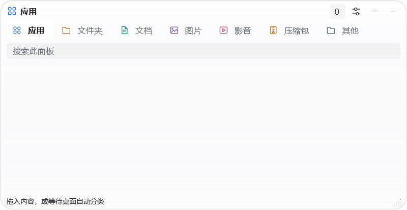 | 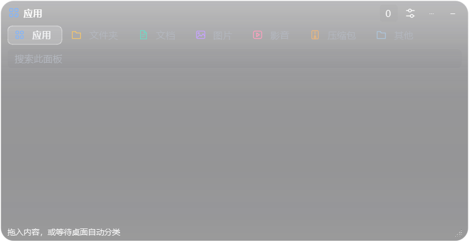 |

本次用户已要求恢复运行测试，前面“本次未测试”仅属于之前批次。当前采用独立Windows桌面的本轮UI运行检查，覆盖分组图标/点击/排序保存、自由尺寸与字号、设置操作行、菜单分隔符和便签永久删除。成品启动与退出结果见验收记录；此范围不等于历史全量测试、实体换屏、物理鼠标/OLE拖动或实际安装验证。


便签标题也提供便签图标，保留拖动功能，随每张便签的七种配色变化；液态玻璃、经典纸张与极简纯色三种样式都显示。便签颜色仍通过菜单“便签颜色”独立选择，图标使用更清楚的同色系强调色。


便签标题图标（最终单文件在隔离测试桌面运行，使用演示文字）：

| 液态玻璃 | 经典纸张 | 极简纯色 |
| --- | --- | --- |
| 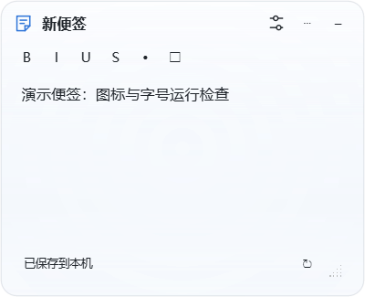 | 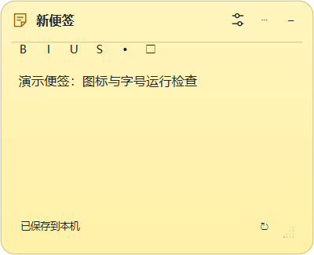 | 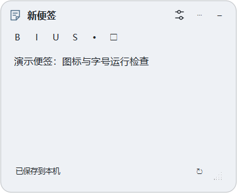 |

本轮源码、目录版及单文件的上述运行检查均通过；手动、自启动、首次启动通过。最终单文件实际退出后，待保存便签已写入，临时解包目录正常清理，详细记录见验收文件。本轮不是历史全量测试，不代表实体换屏或实际安装验证。


### 便签标题与正文字号（1.0.4）

- 标题默认作为文字显示，双击后编辑；Enter保存、Esc取消，点击其他位置也会结束编辑。标题区域随文字长度收紧，长标题限制宽度并可悬停查看，不占满整行。
- 标题栏的滑杆图标直接打开“便签设置”，无需先进入右键菜单。可修改样式、颜色、正文大小、自动收起、置顶与锁定；保存后窗口保持打开。
- 每张便签的正文字号可单独设置8–72像素。标题和按钮仍使用卡片字号；调整全局卡片字号不会覆盖已单独设置的正文。点击“跟随卡片”可恢复默认关系。字号参照随屏幕/整体缩放适配，独立宽高不受影响。
- 正文字号包含在本机保存、配置导入导出、最近删除恢复和异常退出备份中。取消或保存失败保留原设置，编辑标题时正文自动保存不会写入未确认的标题。

以上补充覆盖前面“所有便签正文必须跟随卡片字号”的旧说明。本轮进行隔离桌面运行检查及成品启动/退出验证，实际结果见验收记录。


当前交付版本：**1.0.4**（Windows文件版本1.0.4.0），按用户要求从1.0.3只递增一次，包含本节便签标题和正文字号修改。


1.0.4 便签编辑与设置（最终单文件的隔离运行截图，演示数据）：

| 紧凑标题与独立正文字号 | 标题栏直接进入便签设置 |
| --- | --- |
| 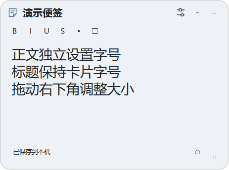 | 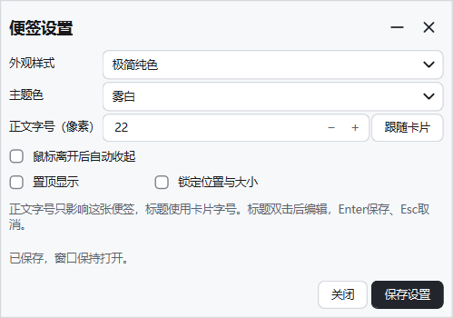 |


### 后续构建与快速检查

默认 `./build.ps1 -Deliver` 使用Quick：目录版新配置启动一次、最终单文件核心运行检查一次，避免源码、目录与单文件重复同套测试。按需使用 `-TestMode Runtime`（扩展运行）、`-TestMode Full`（历史全量入口）、`-SkipTests`（明确未测试）。默认复用增量缓存，只有需要全新构建时加 `-Clean`。本轮检查范围及耗时记录在构建回执，快速检查不代表全量验收。

桌面卡片标题栏现在也有设置按钮，直接打开当前卡片的外观与收起设置，保留“⋯”中的其他操作。


### 桌面卡片设置同步（1.0.4 同日修订）

按当前要求，桌面收纳卡片的材质、颜色模式、主题色、高光、不透明度、模糊、锁定、自动收起、收起形状和胶囊比例全部共用配置。主设置与标题栏“卡片设置”都修改同一份值，保存后应用到全部现有及新建卡片，另一个已打开入口的同名控件刷新为最近保存的值。

旧的单卡片外观覆盖不再使用，以主设置保存值为准；各卡片位置、宽高、内容、分组和视图仍分别保存，便签独立正文与外观设置不受影响。未保存或保存失败的输入不改变已生效配置。上文“每张桌面面板可单独覆盖外观”属于旧规则，以本节为准。

卡片文件快捷键：Ctrl+A 全选、Ctrl+C 复制、Ctrl+X 剪切、Ctrl+V 粘贴到桌面、Delete 删除原文件（先确认）、F2 重命名（单选）、Enter 打开、Alt+Enter 属性、F5 刷新。重命名会同步更新其他卡片中的引用；删除原文件与“移除收纳引用”是不同操作。

文件名自动换行，最多三行，超长末行省略，可悬停查看完整路径。小图标、大图标和列表均保持原有图标尺寸；卡片读取 Windows Shell 的实际图标与角标，依赖本机加密软件已注册且可用的 Shell 图标处理器，不通过文件扩展名猜测加密状态。F5 可立即重新读取状态。

### 多合并组与拖拽分组

桌面收纳支持多个独立合并组，每组分别保存页面、位置、大小和收起状态。首次启用合并默认将卡片放入同一组，之后可自由拆分。

打开“卡片分组”，将卡片拖入目标合并组；拖到“独立显示”即可拆出，组内拖动调整页面顺序。支持 Ctrl / Shift 多选后批量移动；选中卡片再点“新建合并组”可直接组成新组，双击组名可改名。勾选只控制卡片是否显示。删除合并组会把成员移回默认组，保留文件和引用。修改后点“保存分组”，关闭会放弃本页未保存的调整。

### 更多时钟样式

时钟设置增加“日历周览”“时光进度”“月历看板”。时光进度展示今日、本周、本月和本年已过比例，年份按实际天数计算并兼容闰年；月历展示完整月份并标出今天。各样式沿用独立字体、文字效果、颜色、背景和锁定设置，按分钟更新，不增加联网服务或秒级动画。

Dock、桌面收纳、便签和时钟会记住用户主动选择的显隐状态。退出、游戏模式和关机时的临时隐藏不会覆盖该选择；注销或关机收到系统会话保存通知时会保存当前配置和待保存内容。程序设置仍集中在用户数据目录，移动单文件不会创建一套新的显示偏好。

时钟主文字加粗，日期和进度标签采用更清晰的文字；玻璃文字保留轻微光泽，减少透明混色造成的模糊。

### 独立日历与卡片风格

设置的桌面收纳页面或托盘“桌面日历”菜单可单独开启日历。它与时钟分别保存显隐、位置、大小、锁定和外观；支持上个月、下个月及回到今天。日历按日刷新，月历浏览无需联网。

卡片风格提供极光玻璃、浅色渐变、柔和纸卡、极简大字四种方向，装饰色沿用当前主题色，默认保持浅色。时钟和日历可在各自外观设置中选择跟随或单独使用一种风格。全透明预设保持透明。

时钟采用更舒展的数字展示字体，可在设置中换回原字体。点击时钟的翻面按钮可切换时钟与月历；点击便签的翻面按钮可查看、勾选和添加待办，待办同步保存在便签正文中。翻面只由点击触发，文件卡片保持稳定以支持拖放。动画结束会释放临时截图。

设计来源与许可见 [卡片设计参考](docs/design-references.md)。

### 浅色卡片效果

| 极光玻璃 | 浅色渐变 | 柔和纸卡 | 极简大字 |
| --- | --- | --- | --- |
| 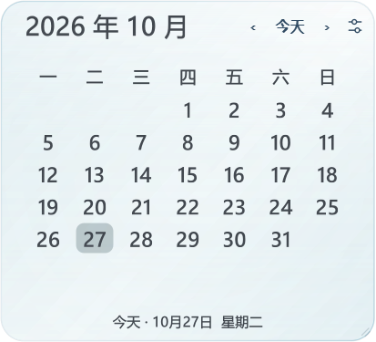 | 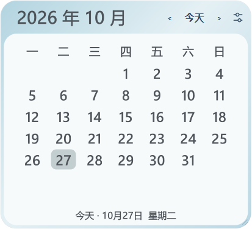 | 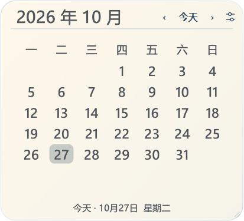 | 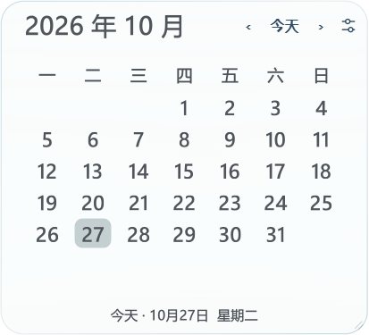 |

| 数字展示字体 | 便签待办背面 |
| --- | --- |
| 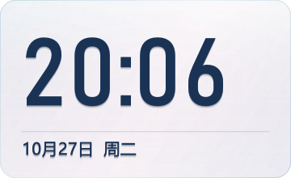 | 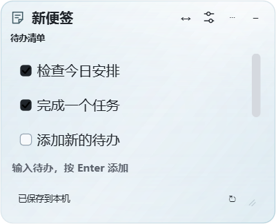 |

以上为临时配置和演示内容的实际窗口截图。

时光进度的条形随卡片尺寸加粗，三条进度使用同一主题色系的柔和渐变；时间、日期、星期和百分比采用更清晰的排版，中文使用无衬线字体，百分比与进度条右端对齐。

新版时光进度在透明蓝色背景上的实际渲染效果：

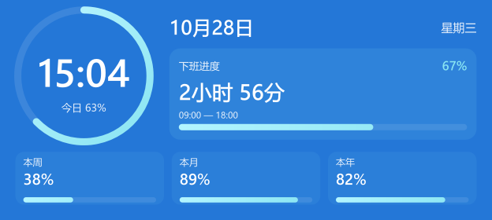

## 源码结构

应用代码、自动检查、构建工具与资源已分别归档，根目录只保留启动和构建入口及项目文档。

```text
BigFishDockpro/
├─ app/               应用代码
├─ tests/             自动检查与测试夹具
├─ tools/             构建、隔离检查、版本与源码导出工具
├─ assets/            图标与 Windows 清单
├─ docs/              功能说明、效果截图与设计参考
├─ licenses/          第三方许可证
├─ dock.py            源码启动入口
├─ build.ps1          一键构建入口
├─ bootstrap.ps1      依赖准备入口
└─ version.json       统一版本信息
```

启动仍可使用 `1-启动.bat`；构建使用 `./build.ps1`。源码导出工具位于 `tools/release_tools.py`，隔离检查工具位于 `tools/run_isolated_test.py`。开发过程输出保存在忽略的 `artifacts/`、`build/`、`dist/`、`release/` 中，不带入精简源码。

## 时钟设计与工作进度

所有时钟样式与独立月历更新了配色、字体及横竖布局。时光进度保留圆环，加入下班倒计时和周/月/年指标卡；支持上下班时间、跨夜、休息扣除、工作周、2026 法定节假日/调休、额外休息日与上班日。未收录年份明确提示并支持年度日历导入。

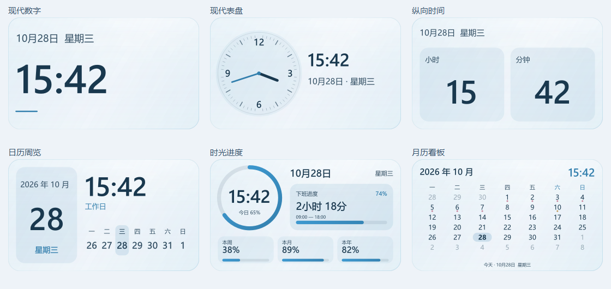

详细控制和日历数据格式见[时钟设计与工作进度](docs/时钟设计与工作进度.md)。
