# 大肥鱼Dock · BigFishDockpro

一款面向 Windows 的桌面整理与美化工具，把常用应用、桌面文件、便签、时钟和日历放在随手可用的位置。

**玻璃质感 · 应用快捷启动 · 桌面分类收纳 · 便签与待办 · 时钟与日历**

[项目主页](https://github.com/HuoXiaolin/BigFishDockpro) · [版本记录](CHANGELOG.md) · [使用说明](使用说明.md)

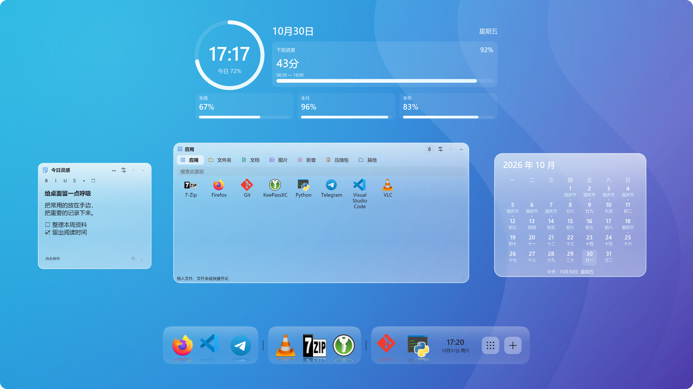

## 功能特色

### 资源胶囊：监控、AI 额度与音乐

- 桌面胶囊和任务栏监控分别开启；CPU、GPU、内存、网速、FPS、温度、频率、功耗、电压、风扇、水泵和显存等项目可独立选择，未提供的传感器默认隐藏。
- 下载、上传和合计流量按日、月、年累计，可查看历史记录；数据保存在本机，重启后保留。
- 任务栏支持 2–24 像素字号；缩小后文字、间距和音乐组件同步收紧，空间不足时使用单行或分页。资源读数按上限的 60% / 80% 分别变黄、变红，低于 60% 为绿色。
- 任务栏组件可选靠左、居中或靠右，自动避让 Windows 11 的开始菜单、应用按钮和托盘。默认置底，选择置顶可在浏览器或无边框应用全屏时保留已验证的显示位置。任务栏监控与桌面胶囊可分别开启「鼠标穿透」，并从托盘关闭。
- 横向任务栏可并排显示音乐封面、曲名、上一首/播放暂停/下一首、真实声音律动和进度细线，五类组件可分别勾选，也可只保留频谱或封面图标。音乐与资源文字整体上下居中，默认跟随 Windows 系统配色；可在「任务栏监控」设置或右键菜单开启独立的「文字阈值变色」，按上限的 60% / 80% 将数值变黄、变红，低于 60% 为绿。音乐另有独立「多彩样式」开关，控制频谱与进度线。关闭的组件让出空间，读数按实际宽度紧凑排列；仅在经过检测的任务栏空位显示，空间不足时缩减音乐信息并对读数分页。
- 「收起显示」可调整读数顺序，「任务栏监控」可调整监控列顺序。九宫格资源胶囊按钮直接启用或关闭桌面组件。
- 收起显示采用小字号、紧凑占用环和固定间距，默认高 44 像素、宽度随内容收紧。CPU/内存/GPU/网速及 AI、音乐、天气可勾选优先常驻。窄尺寸使用双行排列，其余内容分页。资源、AI、音乐、流量、天气五栏共用展开尺寸，默认 560 × 300。资源页同组参数并排，可随宽度换行。可直接拖动四边或四角调整大小，收起最小 96 × 28，展开最小 260 × 180。
- 在「资源胶囊设置 → 桌面监控 → 展开后默认页面」可选天气等栏目，也可沿用上次查看的页面。胶囊右键菜单有相同入口。所选栏目关闭时打开资源页。
- AI 额度可读取本机已登录的 Claude、Codex、Cursor、Antigravity、ZCode、DeepSeek Harness、Kimi、OpenCode、Pi、Grok Bot，最多同时选择 7 项；展开查看套餐、配额和重置倒计时。同一 AI 页面合并额度与统计，支持今天/昨天/7天/30天/全部、工具筛选（单应用时隐藏）、Token/记录/费用趋势、费用环图、缓存命中率和模型明细。无法读取的账号显示真实状态。左下角仅保留「备注」，点击后查看来源和估算说明。
- AI 用量托盘图标可独立开关，连续 Q 环显示剩余额度，70% 起为绿色，40% 起为黄色，10% 及以下为红色，其余为橙色；关闭桌面资源胶囊后仍可通过托盘查看额度和统计，无需开启硬件监控。
- 音乐支持 Windows 媒体会话，并接入 BrimDeck 的网易云、QQ 音乐、酷狗兼容层。可切换和固定播放器，控制播放、进度和播放模式，显示同步歌词及频谱。无进度的直播在匹配到单一应用音频会话时，可暂停或恢复声音。
- 胶囊外圈带连续流动的彩色光环。在「资源胶囊设置 → 背景与配色」可开关光环，选择慢速、中速或快速，默认中速。
- 参考 Wisland 增加贴边圆角、拖拽液桥、断开水滴与松手吸附。资源胶囊默认显示小表情，收起和展开时都位于左侧。「液态与表情」可调整样式、大小、互动和展开方式，精简模式继续支持鼠标跟随。
- 在「资源胶囊设置 → 天气」可启用天气。预设天津、乌鲁木齐、沈阳，支持最多 6 城和收起轮播。天气卡片按晴、云、雨、雪、雾、雷雨绘制背景，默认显示昨天、今天、明天，可切换今天起七天预报。

AI/音乐组件采用 32 KiB 缓冲流式提取日志计量字段，不保留对话或工具输出正文；近期与全部历史共用一个读取缓存。辅助进程设 50 MiB 私有提交内存上限（共享运行库页面另计），达到预算时保留上次统计并延后重试。实测与口径见[内存优化验证](docs/资源与内存优化验证.md)。

流量从启用统计时开始记录，未运行及关闭统计期间不补算；传感器和媒体控制能力取决于设备、驱动及播放器。详细设置见[资源胶囊说明](docs/资源胶囊与媒体.md)。

#### 设置与直播音频

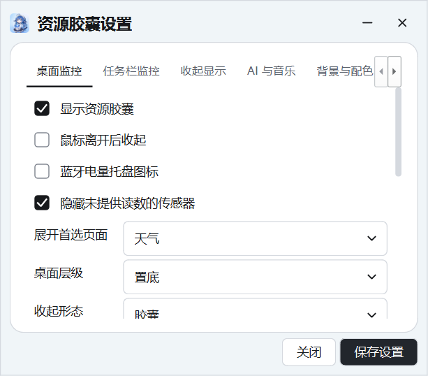

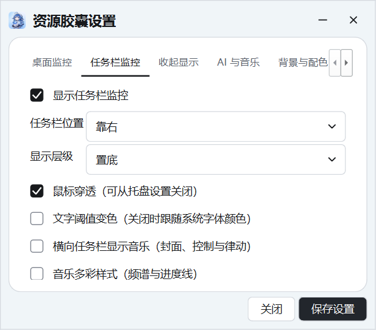

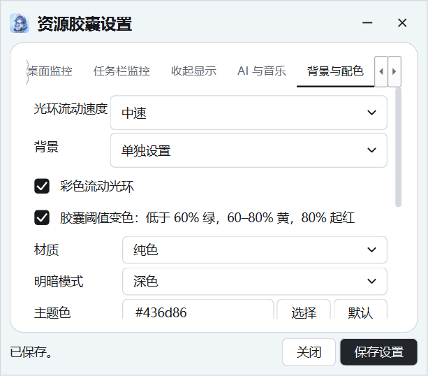

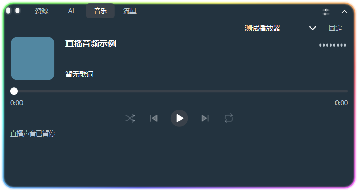

### Dock：常用应用，随手启动

- 支持拖入应用与快捷方式，也可批量添加、批量移除。
- 应用管理支持搜索、多选，区分已固定应用、Windows 工具和正在运行的软件。
- 可修改入口的名称、图标和链接，添加或移除分隔符；图标较多时支持翻页。
- 图标叠放并短暂停留可合并文件夹，支持文件夹命名、搜索、拖入与拖出。
- 提供悬停放大、图标倒影、玻璃材质、外观预设、七种推荐主题色及全透明效果。
- 可显示时间日期，通过可翻页、可排序的九宫格快速切换外观、图标大小及便签/时钟/日历等组件开关，点击＋添加应用；各扩展均可关闭。 [效果与使用说明](docs/Dock快捷设置与倒影.md)

### 桌面收纳：分类清楚，分组合并

- 按应用、文件夹、文档、图片、影音等类型自动分类，也可手动拖入和设置文件格式规则。
- 支持多个独立面板、多个合并组，通过顶部分类栏切换页面，栏目可拖动排序。
- 支持图片缩略图、小图标、大图标和列表视图，以及搜索、文件名或修改时间排序、项目置顶。
- 文件右键调用 Windows 原生菜单，支持复制、剪切、粘贴、删除和重命名等常用操作。
- 收纳保存文件引用，不因收纳或移除引用而搬动、删除原文件；同一文件可被多个面板引用。

### 卡片外观：展开自由，收起轻巧

- 默认采用清透水晶，同时提供柔光流彩、浅色纸玻璃与既有预设，支持整体切换及恢复自定义外观。
- 提供玻璃、浅色渐变、纸卡等外观，支持透明度、模糊、高光、明暗模式和主题色调整。常规卡片使用桌面壁纸。资源胶囊开启实时毛玻璃后采集其后方区域。
- 自由拖动的桌面收纳、便签、时钟、日历和资源胶囊支持屏幕边缘与相邻卡片吸附。可在「设置 → 桌面收纳」开关并调整 2–64 像素距离。
- 桌面收纳面板共用外观设置；独立卡片可自由调整位置与大小，合并页面共用尺寸。
- 启用桌面收纳卡片后默认显示小表情并开启互动。可在标题栏设置或「设置 → 桌面收纳」切换显示、跟随、按压、随机或固定样式及大小。展开、胶囊与圆球都显示，精简模式继续跟随。桌面卡片与资源胶囊的开关分别保存。
- 独立卡片、合并组和便签可分别选择方条、胶囊或圆球收起样式，并支持自动收起、锁定。
- 胶囊和圆球在标题栏水平中心收起，图标居中，悬停显示名称；拖动后仍能恢复展开尺寸。
- 桌面图标可选择同时显示或全部隐藏，支持按屏幕可用区域适配布局。

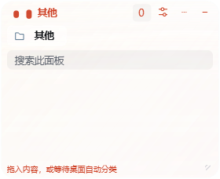

### 便签与待办：随手记录，自动保存

- 提供液态玻璃、经典纸张和极简纯色三种样式，以及多种便签配色。
- 支持双击修改标题、正文独立字号、文字格式、待办清单和搜索。
- 支持新建、隐藏、恢复最近删除及永久删除，内容自动保存到本机。

### 桌面闪念与资源胶囊

- 闪念逐条悬浮在桌面。点开一条可编辑、置顶、设提醒或移到回收站，也可把选中的文字拖到贴边入口。入口支持贴边隐藏，闲置时只留细边、悬停滑出，可独立关闭；拖动可切换左右边缘并记住位置。操作栏按需展开，配色可跟随整体主题，也可选用「活力原色」。
- 桌面资源胶囊可置顶、置底、移动和收起。任务栏双行监控可独立开启，两处共用采样。展开后左侧显示核心负载、显卡、内存和网速，右侧按 CPU 或内存排列进程。背景可跟随整体主题，也可单独设置。支持帧率、温度和功率，两种发行包均内置 PawnIO 离线安装程序。
- 蓝牙电量可独立放在托盘。每个圆环代表一台设备，低于 15% 变红；桌面和托盘共用一次查询。

### 时钟与日历：时间之外，看见进度

- 提供现代数字、现代表盘、纵向时间、日历周览、时光进度和月历看板。
- 时钟可独立设置字体、字号、字重、配色、背景、布局与显示内容，并预览效果。
- 时光进度展示今日、本周、本月、本年进度与下班倒计时，支持上下班时间、跨夜班次和休息时段。
- 支持工作周、节假日与调休配置，内置 2026 年中国大陆节假日数据，可导入其他年度日历。
- 日历可独立显示为桌面卡片，支持农历、节日名称、已收录年度假期标记、切换月份和回到今天。

### 日常运行：按需开启，记住偏好

- 支持登录时尽早启动、启动路径检测与修复、延迟启动、游戏模式、全屏检测和托盘图标隐藏。任务栏透明在 Windows 任务栏就绪后恢复。
- 支持精简模式及关闭设置一分钟后自动进入，保持组件外观和展开状态，减少后台轮询并释放闲置缓存。
- 壁纸共享缓存限制为约 1 MiB，大尺寸毛玻璃保留半尺寸纹理，文字与边框继续原生分辨率绘制。设置只保留正在编辑的页面，切换时保存草稿并释放控件。编辑时资源详情先收起，实时读数和表情继续显示。闲置时释放已关闭设置及可重建缓存；支持的 Windows 版本使用 Segment Heap。
- 隐藏资源页时停止进程排行和逻辑核心查询；重复动画帧复用布局，采样缓冲复用。后台采样线程降低优先级，界面保留用户设置的进程优先级。
- 保存组件显隐、位置和运行偏好，支持配置导入与导出。
- 设置内可查看本机使用统计，包括启动次数、运行时长与功能使用频率，并可重置统计。
- 可启用屏幕圆角美化，Dock、卡片、便签、时钟和日历按需使用。

### 查找与整理：少找一步，安心调整

- 统一搜索已添加的应用、卡片文件、便签与设置；设置页也可直接搜索选项。
- 最近整理可撤销，覆盖 Dock 入口和卡片引用、分组等操作，原文件不受影响。
- 保存多套桌面布局，切换组件位置、尺寸、显隐及分组，保留内容和主题。
- 手动检查失效入口，重新定位或移除引用；网络和可移动位置不误判为失效。

## 效果预览

以下为程序原生界面的演示组合，使用公开应用图标、虚构便签与示例文件。背景、内容和配色用于展示，不包含个人桌面资料。[演示素材来源](docs/demo-assets/README.md)

### Dock：轻透玻璃与全透明

分组分隔、图标倒影与时间显示，让常用应用和快捷操作各就其位。

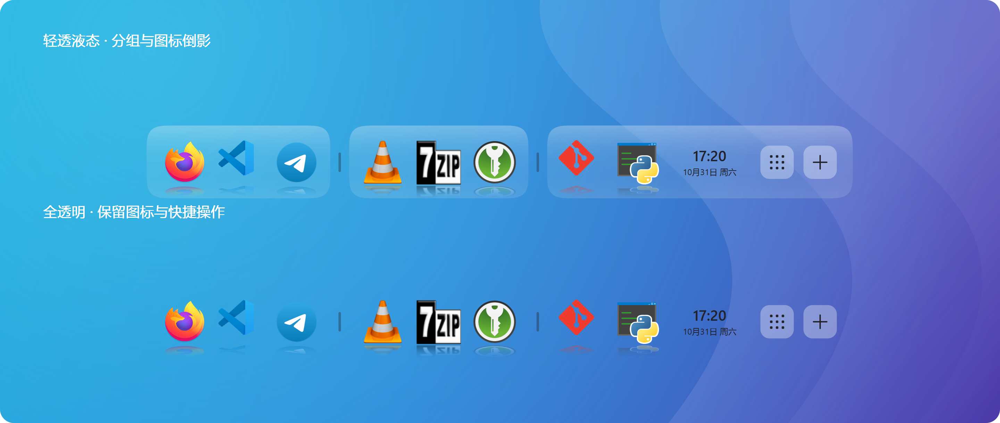

### 桌面收纳：分类展开，轻巧收起

合并栏目与独立图片面板搭配使用；暂时不用时，收起为胶囊或圆球。

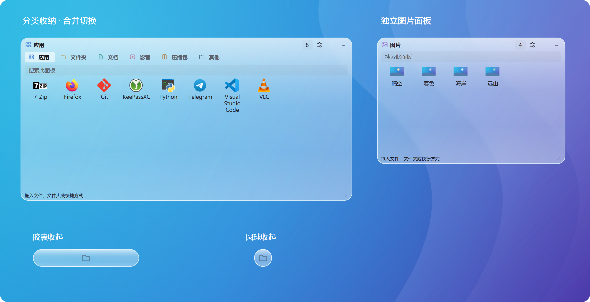

### 便签：三种材质，随手记录

液态玻璃、经典纸张和极简纯色，配合清单与文字格式，记录不同类型的内容。

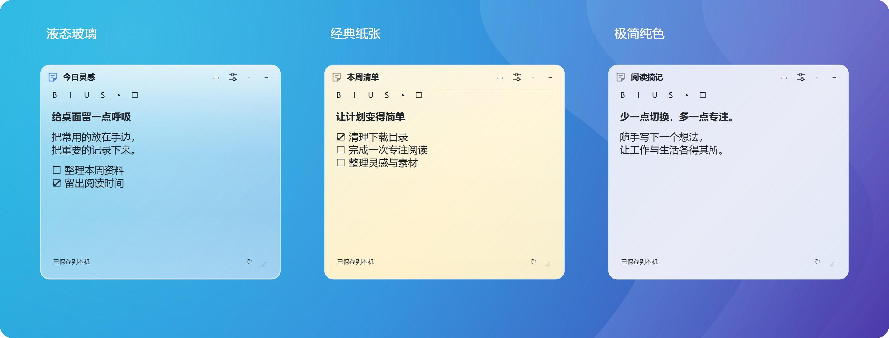

### 时钟与日历：时间与进度，一眼可见

圆环进度、下班倒计时、数字时钟、表盘和独立月历，按自己的习惯组合。

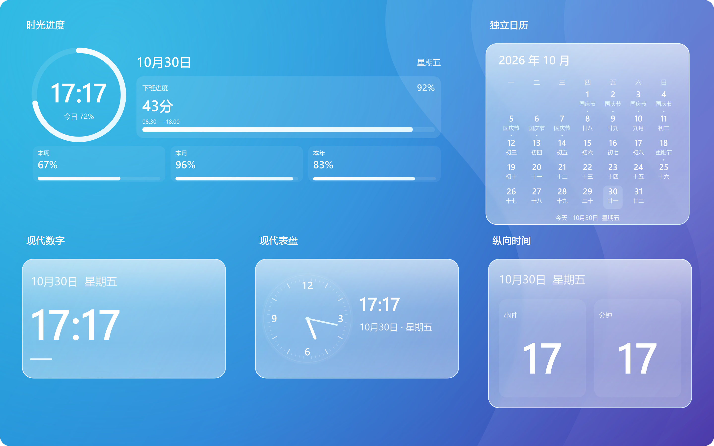

### 应用管理：常用入口，集中整理

搜索、多选与批量添加，分别管理已固定应用、Windows 工具和正在运行的软件。

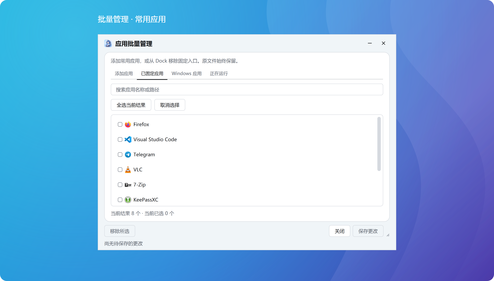

### 设置与快捷设置：细调与快切

分组设置保留精确调整，九宫格快捷设置方便日常切换。[设置说明](docs/轻透分组设置.md)

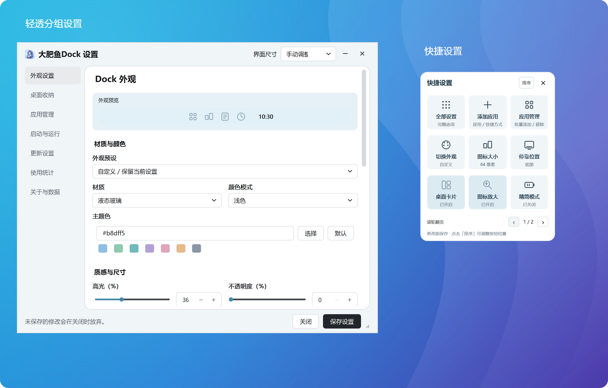

## 支持与赞助

感谢您使用 **大肥鱼Dock**！如果它让您的桌面更整洁、日常使用更顺手，欢迎随心赞助，请作者喝杯咖啡。

您的支持将用于持续维护、功能完善，以及补贴开发过程中的 **AI Token 和工具开销**，也是继续更新的一份动力。赞助完全自愿，欢迎同样通过问题反馈、功能建议或分享项目支持开发。

| 支付宝 | 微信支付 |
| :---: | :---: |
|  |  |

## 开始使用

首次启动会载入默认设置，包括 Dock、时钟、任务栏和资源胶囊的外观与功能偏好。资源胶囊和桌面卡片的表情显示与互动默认开启。桌面卡片、任务栏监控、AI 用量托盘图标和闪念胶囊的组件开关默认关闭。升级或导入旧配置时，缺少的功能选项按内置默认设置补齐，已有设置优先。也可在「设置 → 外观设置 → 使用默认设置」载入预设，再点「保存设置」应用。应用入口、收纳文件、便签和闪念内容按本机配置管理。

支持 **Windows 10 / 11 x64**，无需另行安装 Python。

AI/音乐组件复用电脑已安装的 **.NET 10 Desktop Runtime（x64）**，发行包不再内置该运行库。缺少时仅相关功能提示安装，Dock、便签和资源监控照常使用；可从「资源胶囊设置 → AI 与音乐」打开[微软官方下载页](https://dotnet.microsoft.com/en-us/download/dotnet/10.0)。Windows 自带的 .NET Framework 4.x 不能替代 .NET 10。

- **免安装版**：运行 `BigFishDockpro.exe`。
- **安装版**：运行 `BigFishDockpro-Setup-x64.exe`，按提示完成安装。
- 首次运行默认开启 Dock、桌面收纳和屏幕圆角。收纳分类合并成一张卡片，并以圆球收起。右键 Dock 可进入设置和应用批量管理。
- Windows 11 x64 的任务栏特效可从单文件版「外观设置 → Windows 任务栏」离线安装，也可在完整安装包中勾选安装。Windows 10 使用内置后端。
- 可在设置或对应菜单中开启便签、时钟和日历。
- 个人配置保存在 `%APPDATA%/BigFishDock`；更换电脑或备份前，可在设置中导出配置。导出文件可能包含个人路径和便签内容，请妥善保管。

## 更多说明

[桌面收纳](docs/桌面收纳面板.md) · [便签卡片](docs/便签卡片.md) · [时钟与工作进度](docs/时钟设计与工作进度.md) · [尺寸与显示适配](docs/卡片尺寸与界面适配.md) · [运行与更新](docs/运行模式与更新.md) · [查找整理与三套主题](docs/查找整理与主题.md)

开发与构建请参阅 [项目说明](docs/项目说明.md) 和 [源码结构](docs/源码结构.md)；历史改动见 [更新日志](CHANGELOG.md) 与 [历史记录](CHANGELOG_HISTORY.md)。

本轮运行内存优化的测试口径、样本和边界见[资源与内存优化验证](docs/资源与内存优化验证.md)。

## 来源与许可

本项目基于 [WKaleXD/iOS-style-Dock](https://github.com/WKaleXD/iOS-style-Dock) 开发，维护作者为 HuoXiaolin。感谢原项目及相关开源工具的贡献。

基础项目的 MIT 许可与版权声明保留于 [LICENSE](LICENSE)。随 GPL PyQt5 分发的组合二进制遵循 GPLv3，第三方许可及设计参考见 [第三方说明](licenses/THIRD-PARTY-NOTICES.md) 与 [设计参考](docs/design-references.md)。

### 项目参考

| 项目 | 本项目中的用途 | 来源与许可 |
| --- | --- | --- |
| iOS-style-Dock | Dock 基础代码及原始交互 | [WKaleXD/iOS-style-Dock](https://github.com/WKaleXD/iOS-style-Dock)，MIT |
| BrimDeck | 收起胶囊交互参考；复用 AI 配额/用量与音乐数据连接代码。本应用使用自己的 Qt 界面、主题和材质 | [MoFeng2223/BrimDeck](https://github.com/MoFeng2223/BrimDeck)，[中文说明](https://github.com/MoFeng2223/BrimDeck/blob/main/README.zh-CN.md)，Apache-2.0 |
| OpenQuota | AI 用量筛选、费用分布、趋势图及分段额度托盘图标的设计参考；以原生 Qt 实现，不捆绑其运行时 | [deviffyy/OpenQuota](https://github.com/deviffyy/OpenQuota)，[固定版本](references/OpenQuota-PIN.json)，[MIT](licenses/OpenQuota-MIT.txt) |
| Wisland | 将液态形状、弹簧与表情代码适配到 PyQt5，参考局部毛玻璃采集 | [AsamiAkito/wisland](https://github.com/AsamiAkito/wisland)，[固定版本](references/Wisland-PIN.json)，[MIT](licenses/Wisland-MIT.txt) |
| BlueGauge | 蓝牙设备电量与独立托盘显示的功能参考 | [iKineticate/BlueGauge](https://github.com/iKineticate/BlueGauge)；本应用使用自己的设备读取与环形绘制 |
| LiteMonitor | 硬件读数与任务栏监控的功能参考 | [Diorser/LiteMonitor](https://github.com/Diorser/LiteMonitor)；本应用保留自己的监控架构 |
| PresentMon | 读取应用实际呈现帧，计算 FPS | [Intel PresentMon](https://github.com/GameTechDev/PresentMon)，[许可](licenses/PresentMon-LICENSE.txt) |
| PawnIO / PawnIO Modules | 支持的 CPU 温度与封装功率读取 | [PawnIO](https://github.com/namazso/PawnIO)，[模块](https://github.com/namazso/PawnIO.Modules)，[本地许可与说明](licenses/PawnIO-Modules-NOTICE.txt) |
| TranslucentTB | Windows 11 任务栏外观后端 | [TranslucentTB](https://github.com/TranslucentTB/TranslucentTB)，[许可](licenses/TranslucentTB-LICENSE.txt) |

BrimDeck 参考源码固定在提交 `5cbf5596a4163803d2411b96b37f16d925a11986`；原始版权及[许可](licenses/BrimDeck-Apache-2.0.txt)、[第三方声明](licenses/BrimDeck-ThirdPartyNotices.txt)一并保留。适配入口为 `tools/DeckBridge`，参考源码位于 `references/BrimDeck`。构建和数据边界见[资源胶囊说明](docs/资源胶囊与媒体.md)。
