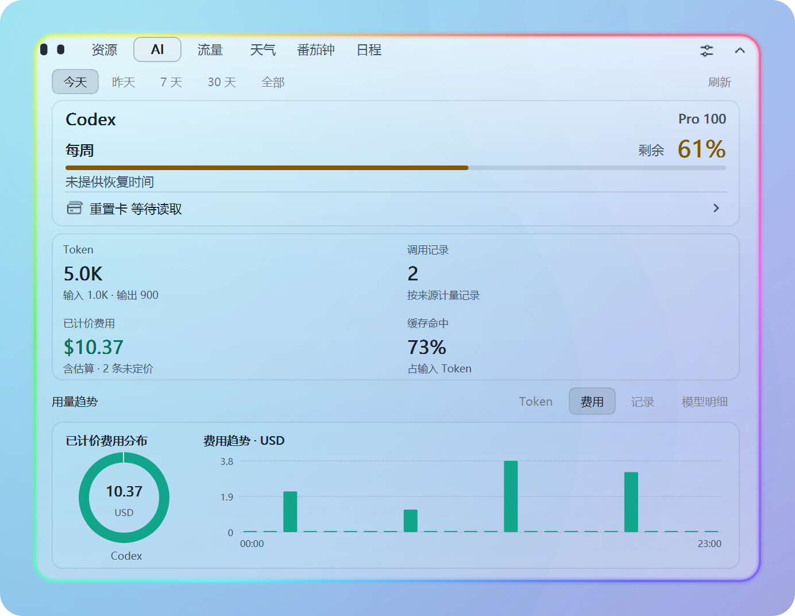
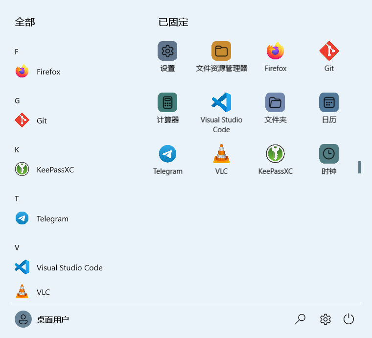
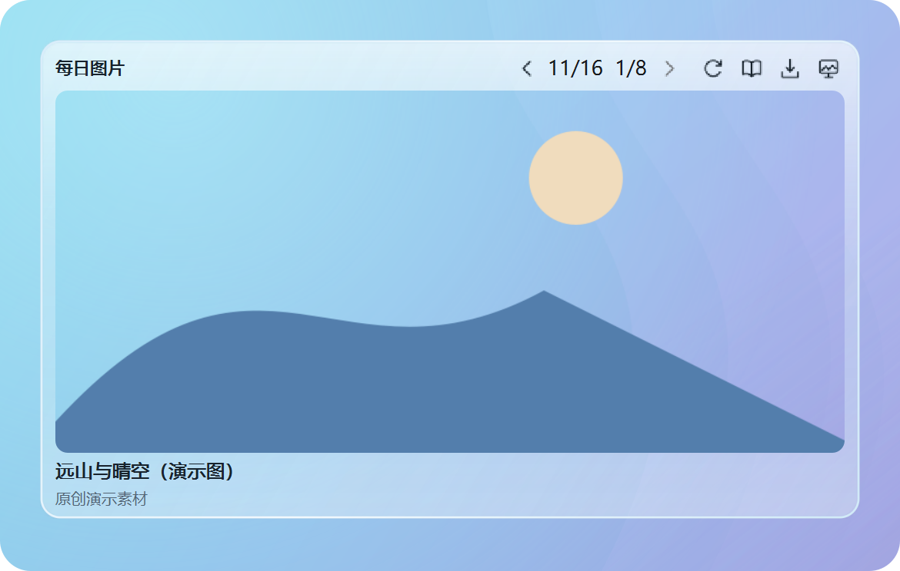
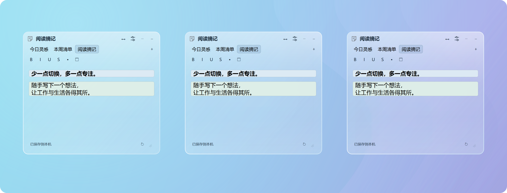

# 大肥鱼Dock · BigFishDockpro

面向 **Windows 10 / 11 x64** 的桌面整理与美化工具。用 Dock 启动应用，用卡片整理文件，用资源胶囊查看电脑状态、AI 用量和日程。Windows 11 的开始菜单、搜索和通知也能使用同套玻璃外观。

[下载发行版](https://github.com/HuoXiaolin/BigFishDockpro/releases) · [使用说明](使用说明.md) · [更新日志](CHANGELOG.md) · [问题反馈](https://github.com/HuoXiaolin/BigFishDockpro/issues)


*界面演示使用原创背景和示例数据，玻璃面板采用 90% 透明度。*

## 下载与上手

| 版本 | 使用方式 |
| --- | --- |
| 安装版 | 运行 `BigFishDockpro-Setup-x64.exe`，按向导完成安装。 |
| 免安装单文件版 | 将 `BigFishDockpro.exe` 放在固定位置后运行，无需安装 Python。 |
| 内置 .NET 单文件便携版 | 双击 `BigFishDockpro-Portable-dotNET-x64.exe` 即可运行。程序、AI 和音乐组件以及 .NET 10 桌面运行库均包含在这一个 EXE 中。 |

1. 将快捷方式拖入 Dock，将文件或文件夹拖入桌面收纳卡片。
2. 右键 Dock 打开设置，调整材质、位置和图标，按需开启桌面组件。
3. 更换电脑时，可在「数据与备份」导出配置。三个版本共用 `%APPDATA%\BigFishDock` 中的配置。

## Dock 与桌面收纳

Dock 支持分组、图标倒影、圆形图标、自动隐藏、窗口切换和统一搜索。右键可批量管理应用，也可保存多套布局。

桌面收纳可按应用、文件夹、文档、图片等分类。卡片可独立摆放、合并切页、搜索或收起为胶囊和圆球。文件仍保存在原位置，整理操作可撤销。

## 资源胶囊

收起时查看状态和提醒，展开后切换资源、音乐、AI、流量、天气、番茄钟、日程和新闻。栏目可拖动排序或拆成桌面卡片，胶囊可固定到任务栏。内部卡片随宽度切换单列或双列。

胶囊和托盘可以各养一只小动物，可选三花猫、黑背白围脖的小狗和暖灰杏粉的小兔。默认随 CPU 占用加速，也可改为 GPU、内存、磁盘、网络或三档匀速。悬停或单击可见「小狗 CPU 50%」这样的实时读数。胶囊的小动物在「资源胶囊设置 → 收起显示」调整，托盘小动物在「任务栏」调整。


- **监控与流量**显示 CPU、GPU、内存、网速、FPS 和硬件传感器读数。流量可按应用查看实时排行与历史。蓝牙及支持的 2.4G 外设共用电量显示，支持别名和诊断导出。
- **AI 用量**显示套餐、额度周期、恢复时间、Token 和费用，也支持自定义用量接口。托盘可显示多环额度或余额，Codex 卡片显示重置卡数量和有效期。
- **日程与专注**支持同步日程、倒数日、番茄钟和喝水提醒。提醒中的日程置顶，收起时优先显示提醒，日历同步标记日程与倒数日。
- **媒体与资讯**提供播放控制、歌词、频谱、天气和 RSS。每个订阅源都可独立开启或关闭。

<details>
<summary>查看 AI 用量与流量排行</summary>




</details>

## 开始菜单与系统外观

Windows 11 的玻璃网格左侧列出全部应用，右侧展示固定应用。底栏提供用户、电源、搜索和设置入口。放大镜打开与开始菜单同尺寸的 Windows 原生搜索，保留推荐和单列匹配结果。账户和电源菜单沿按钮弹出，并跟随当前材质与配色。

| 开始菜单 | Windows 搜索 |
| --- | --- |
|  |  |

*两张均为使用演示数据生成的样式示意图。*

快速设置、媒体控制、通知和日历保留系统位置。外观可跟随 Dock、跟随系统或自定义，也可恢复系统默认开始菜单。详见[系统面板外观](docs/系统面板外观.md)。

## 每日图片与桌面组件

在「设置 → 桌面组件 → 桌面文字水印」自定义文字、颜色、字号、角度、密度和不透明度。可在主屏上、下、左、右或居中显示一处，也可在各屏幕平铺。桌面置底和窗口置顶均支持鼠标穿透，托盘右键菜单与 Dock 快捷设置可随时开关水印。

每日图片支持浏览必应图片、查看故事、下载原图、设为壁纸和轮播本地图片。断网时继续显示上一次成功读取的图片和说明，恢复连接后自动更新。下载原图可自选位置，设为壁纸会保存到当前用户的图片文件夹。



- **便签与闪念**支持标签页、清单、文字格式和纸张材质。
- **时钟与日历**支持月历、表盘、倒数日与工作进度。时钟翻面可看农历卡片，24 个节气和 12 个传统节日各配两幅彩绘、四段诗谚，胶囊可显示节气倒计时。

- **桌面频谱**随系统音频显示线条、柱形、圆环、镜像或点阵。
- **原生卡片**通过编辑器或 JSON 组合文字、图片、本地数据和在线内容。


<details>
<summary>查看时钟、日历和便签</summary>




</details>

## 运行要求与数据

- **基础运行**：Windows 10 / 11 x64，发行包自带 Python 与 Qt 运行文件。
- **AI 与音乐**使用 .NET 10 Desktop Runtime x64。内置 .NET 单文件版自动加载随附运行库，安装版和轻量单文件版使用系统运行库。账号、额度周期和费用取自对应数据源。[微软运行库下载](https://dotnet.microsoft.com/en-us/download/dotnet/10.0)
- **硬件传感器**：部分读数需要 PawnIO。安装版和免安装版首次发现缺少驱动时，会按当前权限在后台尝试安装一次；失败时说明用途和来源，并提供官方安装包的手动安装入口。读数范围取决于硬件与驱动。
- **任务栏外观**：Windows 11 可使用内置离线包安装 TranslucentTB；Windows 10 使用应用内置后端。
- **流量与外设**：按应用采集需要 Windows ETW 权限，历史从启用时开始记录；2.4G 电量需要匹配设备协议，诊断文件不等同于已完成适配。

导出的配置可能含个人路径、便签及接入设置。截图的演示内容及素材来源见[演示素材来源](docs/demo-assets/README.md)。

## 使用文档

| 想了解什么 | 文档 |
| --- | --- |
| 从哪里开始、如何更新 | [使用说明](使用说明.md) · [运行与更新](docs/运行模式与更新.md) |
| Dock、收纳和主题 | [Dock 快捷设置](docs/Dock快捷设置与倒影.md) · [桌面收纳](docs/桌面收纳面板.md) · [查找与整理](docs/查找整理与主题.md) |
| 资源、AI、音乐和日程接入 | [资源胶囊与媒体](docs/资源胶囊与媒体.md) |
| 蓝牙与 2.4G 外设适配 | [2.4G 诊断、报文采集与配置导入](docs/2.4G外设适配.md) |
| 便签、时钟与自定义卡片 | [便签](docs/便签卡片.md) · [时钟与工作进度](docs/时钟设计与工作进度.md) · [原生卡片配置](docs/原生卡片配置.md) |
| 窗口尺寸、显示与性能 | [尺寸适配](docs/卡片尺寸与界面适配.md) · [资源与内存验证](docs/资源与内存优化验证.md) |

## 开发与构建

项目使用 **Python / PyQt5**，部分数据采集由 C# 辅助进程完成。在 Windows PowerShell 中执行：

```powershell
./bootstrap.ps1
./build.ps1
```

工具链配置、隔离验证和交付流程见[项目说明](docs/项目说明.md)；模块入口见[源码结构](docs/源码结构.md)。版本改动见[更新日志](CHANGELOG.md)及[历史记录](CHANGELOG_HISTORY.md)。

## 开源许可与致谢

项目源码采用 [GPL-3.0-only](LICENSE)。原 iOS-style-Dock 的 [MIT 版权与许可声明](licenses/iOS-style-Dock-MIT.txt) 随项目保留。第三方组件各自遵循原许可，完整说明见[第三方声明](licenses/THIRD-PARTY-NOTICES.md)与[设计参考](docs/design-references.md)。

<details>
<summary>参考项目与素材来源</summary>

| 项目 | 用途 |
| --- | --- |
| [iOS-style-Dock](https://github.com/WKaleXD/iOS-style-Dock) | Dock 代码与交互，保留原 MIT 声明。 |
| [FullWidget](https://github.com/hmgvibe/FullWidget) | 天气、媒体与可编辑组件的设计参考。 |
| [BrimDeck](https://github.com/MoFeng2223/BrimDeck) | 复用 AI 与音乐数据连接代码；界面采用本应用的 Qt 实现。源码固定版本见 [PIN](references/BrimDeck-PIN.json)，保留 [Apache-2.0 许可](licenses/BrimDeck-Apache-2.0.txt)与[第三方声明](licenses/BrimDeck-ThirdPartyNotices.txt)。 |
| [OpenQuota](https://github.com/deviffyy/OpenQuota) | 用量统计与额度托盘的设计参考，[固定版本](references/OpenQuota-PIN.json)及 [MIT 声明](licenses/OpenQuota-MIT.txt)。 |
| [LobeHub Icons](https://github.com/lobehub/lobe-icons) | AI 供应商图标，[MIT 与素材来源](licenses/LobeHub-Icons-MIT.txt)。 |
| [Wisland](https://github.com/AsamiAkito/wisland) | 液态形状、弹簧与表情代码适配，[固定版本](references/Wisland-PIN.json)及 [MIT 声明](licenses/Wisland-MIT.txt)。 |
| [Uiverse · SelfMadeSystem](https://uiverse.io/SelfMadeSystem/pretty-treefrog-77) | 启动动画的流动描边参考。 |
| [Freesound](licenses/THIRD-PARTY-NOTICES.md#natural-reminder-sounds) | 自然提醒音录音与 CC0 许可。 |
| [BlueGauge](https://github.com/iKineticate/BlueGauge) | 蓝牙电量与托盘的功能参考。 |
| [HaloBattery](https://github.com/HeyOkay/HaloBattery) · [ChargeDock](https://github.com/SgZincanya/ChargeDock) | 2.4G 电量协议及接收器兼容信息参考。 |
| [LiteMonitor](https://github.com/Diorser/LiteMonitor) | 硬件读数与任务栏监控的功能参考。 |
| [PresentMon](https://github.com/GameTechDev/PresentMon) | 读取实际呈现帧并计算 FPS，[许可](licenses/PresentMon-LICENSE.txt)。 |
| [PawnIO](https://github.com/namazso/PawnIO) · [PawnIO Modules](https://github.com/namazso/PawnIO.Modules) | 支持的 CPU 温度与功率读取，[许可与说明](licenses/PawnIO-Modules-NOTICE.txt)。 |
| [TranslucentTB](https://github.com/TranslucentTB/TranslucentTB) | Windows 11 任务栏外观后端，[许可](licenses/TranslucentTB-LICENSE.txt)。 |
| [Windows 11 XAML Stylers](https://github.com/ramensoftware/windhawk-mods) | 原生系统面板的控件匹配与还原；本应用独立管理后端，[固定源码](references/ShellStyler/PIN.json)和 [GPL v3 许可](licenses/ShellStyler-GPL-3.0.txt)。 |

</details>

## 支持项目

欢迎通过[问题反馈](https://github.com/HuoXiaolin/BigFishDockpro/issues)、功能建议或分享项目支持维护。赞助完全自愿，用于开发工具、AI Token 与日常维护开销。

| 支付宝 | 微信支付 |
| :---: | :---: |
|  |  |
