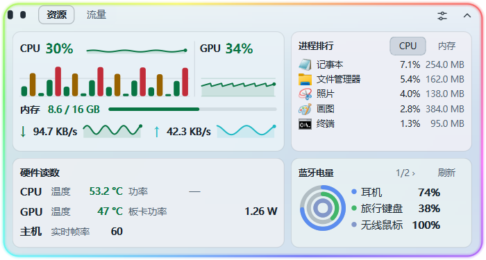
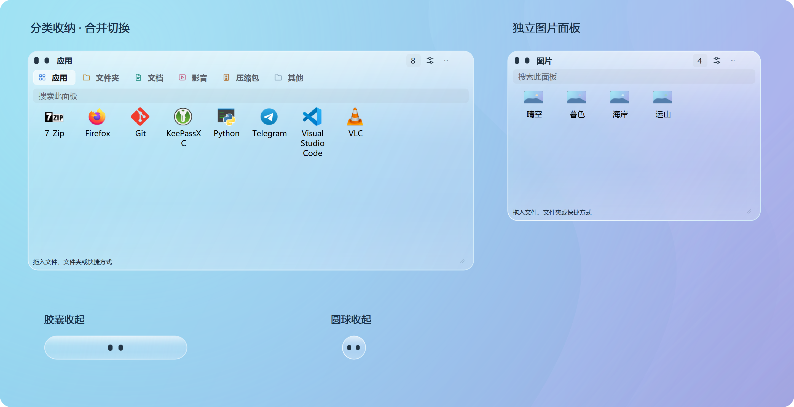
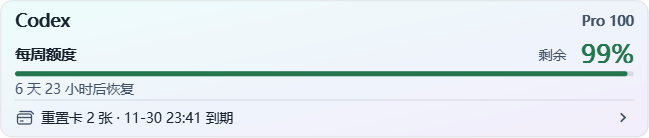

# 大肥鱼Dock · BigFishDockpro

面向 **Windows 10 / 11 x64** 的桌面整理与美化工具：用 Dock 启动应用，用收纳卡片整理文件，用资源胶囊查看电脑状态与日常提醒。

[下载发行版](https://github.com/HuoXiaolin/BigFishDockpro/releases) · [使用说明](使用说明.md) · [更新日志](CHANGELOG.md) · [问题反馈](https://github.com/HuoXiaolin/BigFishDockpro/issues)


## 下载与上手

| 版本 | 使用方式 |
| --- | --- |
| 安装版 | 运行 `BigFishDockpro-Setup-x64.exe`，按向导完成安装。 |
| 免安装单文件版 | 将 `BigFishDockpro.exe` 放在固定位置后运行，无需安装 Python。 |

1. 将应用快捷方式拖入 Dock；将文件或文件夹拖入桌面收纳卡片。
2. 右键 Dock 打开设置，调整外观、位置和图标，或批量管理应用。
3. 在设置中按需开启资源胶囊、任务栏监控、便签、时钟等组件。
4. 更换电脑前，在设置中导出配置。配置保存在 `%APPDATA%\BigFishDock`，免安装版同样使用此目录。

## 核心功能

### Dock：常用应用，随手启动

拖入快捷方式、文件和文件夹，支持分组、批量管理、窗口切换与统一搜索。图标可选默认形状或圆形，搭配倒影、玻璃材质和自动隐藏，按使用习惯调整。

### 桌面收纳：分类整理，保留原文件

将应用、文件夹、文档、图片等归入不同栏目，支持拖放排序、搜索和预览。卡片可独立摆放，也可合并、收起为胶囊或圆球；保存多套布局，整理操作可撤销。收纳引用不改变原文件位置。

### 资源胶囊：监控、用量与提醒集中查看

- **电脑状态**：CPU、GPU、内存、网速、FPS 和硬件传感器；查看流量历史及应用排行。蓝牙与支持的 2.4G 外设共用电量显示，支持别名、诊断导出和适配配置导入。
- **AI 用量**：查看已连接工具的套餐、剩余额度、恢复时间、Token 和费用；支持自定义用量接口。托盘可显示多环额度或余额，Codex 支持重置卡数量与到期详情。
- **日程与专注**：日程同步、番茄钟和喝水提醒。提醒中的日程置顶，胶囊收起时优先显示提醒标题；日程与倒数日同步到日历标记。
- **音乐与内容**：播放控制、歌词和频谱，以及天气、空气质量、每日图片和可独立开关的 RSS 订阅源。

栏目可以拖动排序、拖出成为桌面卡片，再拖回胶囊。胶囊可固定到任务栏；宽度变化时，内部卡片自动切换单列或双列。



<details>
<summary>查看 Dock、收纳与 AI 用量界面</summary>






</details>

## 按需添加桌面组件

| 组件 | 主要用途 |
| --- | --- |
| 便签与闪念 | 随手记录、清单、文字格式和多种纸张材质。 |
| 时钟与日历 | 数字或表盘时钟、农历与节假日、倒数日及工作进度。 |
| 每日图片 | 浏览必应图片、下载原图、设置壁纸，或轮播本地图片。 |
| 音乐频谱 | 跟随系统声音，选择线条、柱形、圆环、镜像或点阵。 |
| 原生卡片 | 用编辑器或 JSON 配置组合文字、图片和数据，接入本地或在线内容。 |

组件支持独立显隐、拖动和尺寸调整，外观可使用应用提供的材质与配色。可手动暂停桌面组件，也可开启全屏自动暂停。

## 系统面板外观（Windows 11）

开始菜单可选系统默认或 Windows 11 玻璃网格。开始菜单、快速设置、媒体控制、通知弹窗和日历在「跟随本应用」时使用同一套 Dock 外观，也可跟随系统或单独设置。系统入口和弹出位置照常使用。详见[系统面板外观](docs/系统面板外观.md)。

## 运行要求与数据

- **基础运行**：Windows 10 / 11 x64，发行包自带 Python 与 Qt 运行文件。
- **AI 与音乐**：需要 [.NET 10 Desktop Runtime x64](https://dotnet.microsoft.com/en-us/download/dotnet/10.0)，缺少时应用提供下载入口。账号、额度周期和费用以数据源实际提供的内容为准。
- **硬件传感器**：部分读数需要 PawnIO。安装版和免安装版首次发现缺少驱动时，会按当前权限在后台尝试安装一次；失败时说明用途和来源，并提供官方安装包的手动安装入口。读数范围取决于硬件与驱动。
- **任务栏外观**：Windows 11 可使用内置离线包安装 TranslucentTB；Windows 10 使用应用内置后端。
- **流量与外设**：按应用采集需要 Windows ETW 权限，历史从启用时开始记录；2.4G 电量需要匹配设备协议，诊断文件不等同于已完成适配。

导出的配置可能含个人路径、便签及接入设置，请妥善保存。截图使用原生界面与演示内容，素材说明见[演示素材来源](docs/demo-assets/README.md)。

## 使用文档

| 想了解什么 | 文档 |
| --- | --- |
| 从哪里开始、如何更新 | [使用说明](使用说明.md) · [运行与更新](docs/运行模式与更新.md) |
| Dock、收纳和主题 | [Dock 快捷设置](docs/Dock快捷设置与倒影.md) · [桌面收纳](docs/桌面收纳面板.md) · [查找与整理](docs/查找整理与主题.md) |
| 资源、AI、音乐和日程接入 | [资源胶囊与媒体](docs/资源胶囊与媒体.md) |
| 蓝牙与 2.4G 外设适配 | [2.4G 诊断、报文采集与配置导入](docs/2.4G外设适配.md) |
| 便签、时钟与自定义卡片 | [便签](docs/便签卡片.md) · [时钟与工作进度](docs/时钟设计与工作进度.md) · [原生卡片配置](docs/原生卡片配置.md) |
| 窗口尺寸、显示与性能 | [尺寸适配](docs/卡片尺寸与界面适配.md) · [资源与内存验证](docs/资源与内存优化验证.md) |

## 开发与构建

项目使用 **Python / PyQt5**，部分数据采集由 C# 辅助进程完成。在 Windows PowerShell 中执行：

```powershell
./bootstrap.ps1
./build.ps1
```

工具链配置、隔离验证和交付流程见[项目说明](docs/项目说明.md)；模块入口见[源码结构](docs/源码结构.md)。版本改动见[更新日志](CHANGELOG.md)及[历史记录](CHANGELOG_HISTORY.md)。

## 开源许可与致谢

项目源码采用 [GPL-3.0-only](LICENSE)。原 iOS-style-Dock 的 [MIT 版权与许可声明](licenses/iOS-style-Dock-MIT.txt) 随项目保留。第三方组件各自遵循原许可，完整说明见[第三方声明](licenses/THIRD-PARTY-NOTICES.md)与[设计参考](docs/design-references.md)。

<details>
<summary>参考项目与素材来源</summary>

| 项目 | 用途 |
| --- | --- |
| [iOS-style-Dock](https://github.com/WKaleXD/iOS-style-Dock) | Dock 代码与交互，保留原 MIT 声明。 |
| [FullWidget](https://github.com/hmgvibe/FullWidget) | 天气、媒体与可编辑组件的设计参考。 |
| [BrimDeck](https://github.com/MoFeng2223/BrimDeck) | 复用 AI 与音乐数据连接代码；界面采用本应用的 Qt 实现。源码固定版本见 [PIN](references/BrimDeck-PIN.json)，保留 [Apache-2.0 许可](licenses/BrimDeck-Apache-2.0.txt)与[第三方声明](licenses/BrimDeck-ThirdPartyNotices.txt)。 |
| [OpenQuota](https://github.com/deviffyy/OpenQuota) | 用量统计与额度托盘的设计参考，[固定版本](references/OpenQuota-PIN.json)及 [MIT 声明](licenses/OpenQuota-MIT.txt)。 |
| [LobeHub Icons](https://github.com/lobehub/lobe-icons) | AI 供应商图标，[MIT 与素材来源](licenses/LobeHub-Icons-MIT.txt)。 |
| [Wisland](https://github.com/AsamiAkito/wisland) | 液态形状、弹簧与表情代码适配，[固定版本](references/Wisland-PIN.json)及 [MIT 声明](licenses/Wisland-MIT.txt)。 |
| [Uiverse · SelfMadeSystem](https://uiverse.io/SelfMadeSystem/pretty-treefrog-77) | 启动动画的流动描边参考。 |
| [Freesound](licenses/THIRD-PARTY-NOTICES.md#natural-reminder-sounds) | 自然提醒音录音与 CC0 许可。 |
| [BlueGauge](https://github.com/iKineticate/BlueGauge) | 蓝牙电量与托盘的功能参考。 |
| [HaloBattery](https://github.com/HeyOkay/HaloBattery) · [ChargeDock](https://github.com/SgZincanya/ChargeDock) | 2.4G 电量协议及接收器兼容信息参考。 |
| [LiteMonitor](https://github.com/Diorser/LiteMonitor) | 硬件读数与任务栏监控的功能参考。 |
| [PresentMon](https://github.com/GameTechDev/PresentMon) | 读取实际呈现帧并计算 FPS，[许可](licenses/PresentMon-LICENSE.txt)。 |
| [PawnIO](https://github.com/namazso/PawnIO) · [PawnIO Modules](https://github.com/namazso/PawnIO.Modules) | 支持的 CPU 温度与功率读取，[许可与说明](licenses/PawnIO-Modules-NOTICE.txt)。 |
| [TranslucentTB](https://github.com/TranslucentTB/TranslucentTB) | Windows 11 任务栏外观后端，[许可](licenses/TranslucentTB-LICENSE.txt)。 |
| [Windows 11 XAML Stylers](https://github.com/ramensoftware/windhawk-mods) | 原生系统面板的控件匹配与还原；本应用独立管理后端，[固定源码](references/ShellStyler/PIN.json)和 [GPL v3 许可](licenses/ShellStyler-GPL-3.0.txt)。 |

</details>

## 支持项目

欢迎通过[问题反馈](https://github.com/HuoXiaolin/BigFishDockpro/issues)、功能建议或分享项目支持维护。赞助完全自愿，用于开发工具、AI Token 与日常维护开销。

<details>
<summary>支付宝 / 微信赞助</summary>

| 支付宝 | 微信支付 |
| :---: | :---: |
|  |  |

</details>
