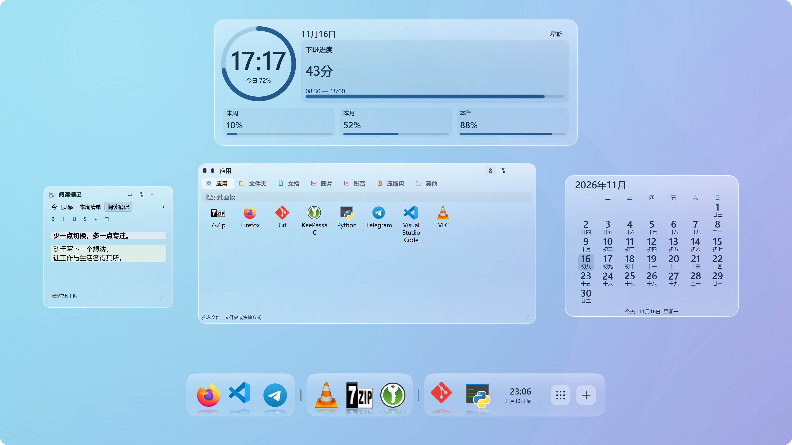
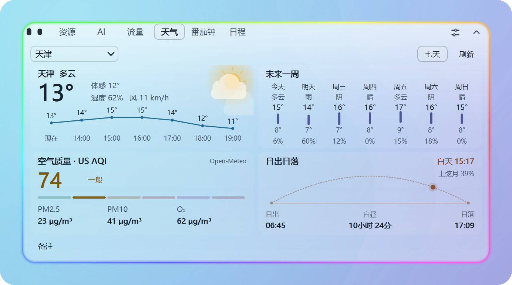
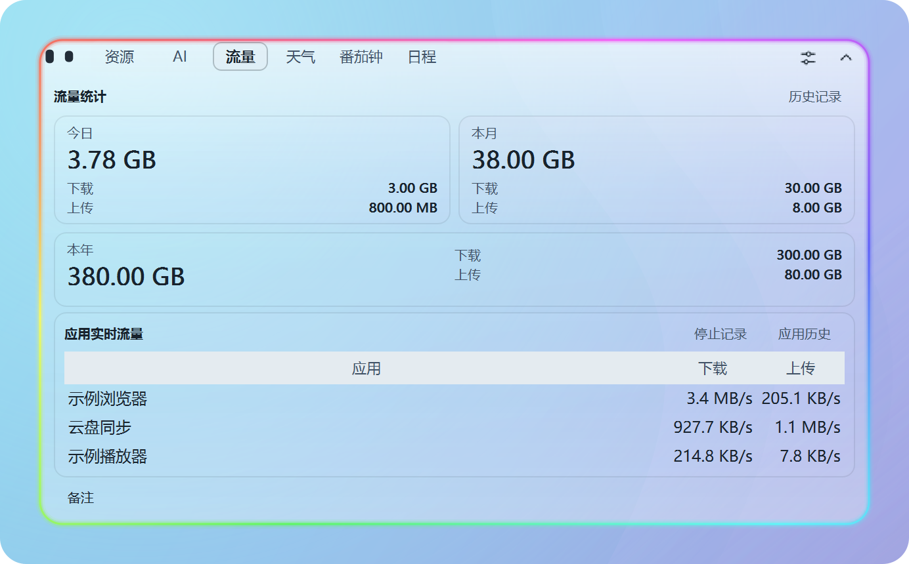
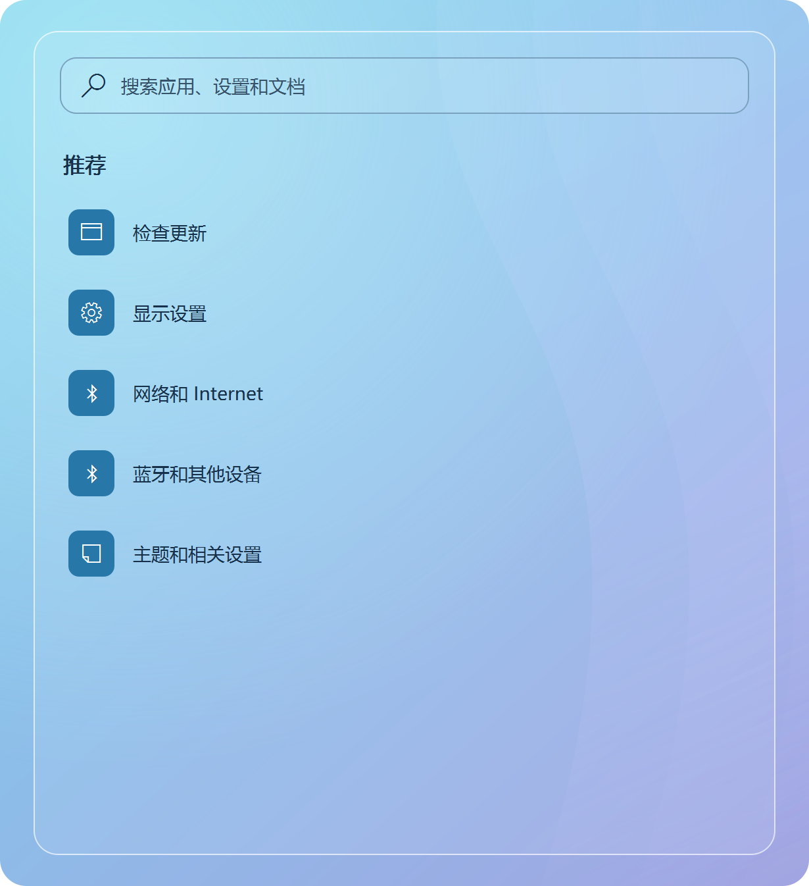
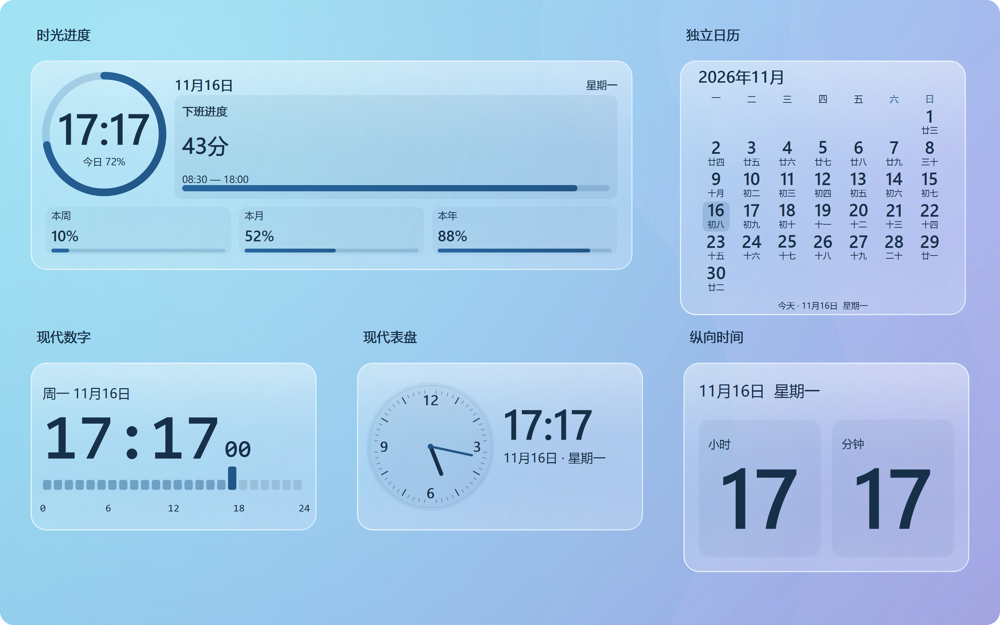

# 大肥鱼Dock · BigFishDockpro

面向 **Windows 10 / 11 x64** 的桌面整理与美化工具。用 Dock 启动应用，用卡片整理文件，用灵动胶囊查看电脑状态、AI 用量和日程。Windows 11 的开始菜单、搜索和通知也能使用同套玻璃外观。

[下载发行版](https://github.com/HuoXiaolin/BigFishDockpro/releases) · [使用说明](使用说明.md) · [更新日志](CHANGELOG.md) · [问题反馈](https://github.com/HuoXiaolin/BigFishDockpro/issues)



*界面演示使用原创背景和示例数据，玻璃面板采用 90% 透明度。*

## 下载与上手

| 版本 | 使用方式 |
| --- | --- |
| 安装版 | 运行 `BigFishDockpro-Setup-x64.exe`，按向导完成安装。 |
| 免安装单文件版 | 将 `BigFishDockpro.exe` 放在固定位置后运行，无需安装 Python。 |

1. 点击 Dock 的「＋」固定应用、文件或文件夹，也可直接拖入。文件和文件夹也能拖入桌面收纳卡片。
2. 右键 Dock 打开设置，调整材质、位置和图标，按需开启桌面组件。
3. 更换电脑时，可在「数据与备份」导出配置。两种版本共用 `%APPDATA%\BigFishDock` 中的配置。

## Dock 与桌面收纳

启用鼠标穿透后，按住左 Alt 或右 Alt 可以临时点击或拖动 Dock、胶囊和桌面卡片，松开即恢复原来的穿透规则。「按住 Alt 临时解除鼠标穿透」默认开启，可在托盘右键的「系统外观 → 鼠标穿透」或「设置 → Dock 外观 → 停靠与交互」切换。

Dock 支持分组、图标倒影、圆形图标、自动隐藏、窗口切换和统一搜索，也可保存多套布局。右键「应用批量管理」可批量添加或移除快捷入口。文件与文件夹沿用桌面卡片的系统图标，图片显示等比例缩略图。Dock 只保存快捷映射，移除入口后原文件和文件夹仍在原处。

「设置 → 外观与系统 → 鼠标样式」可以预览、导入和应用静态或动态指针。本地交付的安装版和单文件便携版内置 11 套方案，包括 Bibata 琥珀、Bibata 冰白、Spirit、Tinted Glass、Future、Layan White、Phinger Light、W11 浅色、酷狗老皮、路飞和 GrokBot-Soft-Pointer。Dock 快捷设置和托盘右键菜单可在指针方案与系统默认之间循环切换。

桌面收纳可按应用、文件夹、文档、图片等分类。卡片可独立摆放、合并切页或搜索，也可以从原位平滑收起为横栏、胶囊或圆球。再次展开时回到原尺寸。文件仍保存在原位置，整理操作可撤销。

在「设置 → Dock 外观」可以预览和选择九套主题。「曜石铜边」搭配石墨缎面和暖铜细边，「青瓷釉面」使用浅青釉色和深绿描边，「落霞丝绒」在莓红绒面上铺开珊瑚色柔光。「整体外观」可将主题同步到桌面组件。

## 灵动胶囊

在「灵动胶囊设置 → 收起显示 → 显示顺序」把已开启的内容分配到靠左、中间、靠右三栏，每栏可以单独排序。中间栏以整个胶囊为基准居中，左右两侧内容较多时各自分页。在「尺寸与分页」可指定自动翻页的区域和间隔，默认三栏都开启，每 6 秒轮换。悬停暂停，滚轮可随时翻页。「色块高度」控制方块和占用环的高度。资源标题与数值保留原有字号和常规字重，两行与日期时间上下对齐。Dock 与收起胶囊的日期和时间均使用粗体。

Dock 和收起胶囊的时钟均为双行居中，上行日期、下行时间。可在「设置 → Dock 外观 → Dock 扩展」和「灵动胶囊设置 → 收起显示 → 日期与时间」分别选择秒数、星期、农历和节日。

在「收起显示 → 键盘与设备状态」选择要看的状态，发生变化时图标展开为文字，5 秒后收回。桌面圆球收到邮件、日程或闹钟提醒时会舒展为短胶囊。开启「表情与吸附 → 贴边隐藏为光条」后，新提醒也能从光条滑出，5 秒后自动收回。贴边隐藏默认关闭。番茄钟页的「正计时与闹钟」可独立于专注倒计时运行。

收起时查看状态和提醒，展开后可切换资源、音乐、AI、流量、天气、新闻、番茄钟、日程和邮件。栏目可拖动排序或拆成桌面卡片，胶囊可固定到任务栏。内部卡片各有自己的功能色。资源总览用雾蓝，进程排行用淡紫，硬件用暖米，电脑状态用青绿。天气卡片随晴雨和晨昏变色。窄窗口自动改为单列。

在「材质与配色 → 光环配色」可以为胶囊单独选择频谱同款的炫彩主题，也可以指定单色，让一束光带着拖尾沿边缘移动。

胶囊和托盘可以各养一只小动物，可选小猫、小狗、小兔、小鸟和小企鹅。蓝背黄胸的小鸟持续振翅、上下飞动，小企鹅侧身朝右，头和肚子保持平稳，两脚轮流迈步，两侧鳍翅前后交替摆动。在同一档位下，所有小动物走完一轮的时间相同。自动速度随占用率变化，50% 为 48 帧/秒，100% 为 96 帧/秒。小鸟在低负载时保持每秒至少 8 帧。匀速有 24、48、96 帧/秒三档。胶囊在「灵动胶囊设置 → 收起显示」调整，托盘在「任务栏 → 托盘小动物」调整。两处可分别选择 CPU、内存、GPU、磁盘或网卡。悬停或单击任一小动物，可同时查看实时占用率和本次 Windows 开机时长。

收起胶囊和托盘中的 AI 额度环用彩色显示剩余额度，浅灰色显示本周期内今天已用的份额。悬停可查看具体百分比。

「灵动胶囊设置 → 资源与阈值 → 硬件设备」为胶囊、桌面资源卡和任务栏监控统一选择 GPU、网卡、磁盘和显示器。默认取最忙 GPU、最忙磁盘，网速汇总连接中的网卡。可固定设备，显示器选择用于亮度和桌面更新帧率。设备断开后保留选择，读数显示「—」。

农历卡片也显示下一公历节日倒计时。元旦、妇女节、植树节、劳动节、青年节、儿童节、教师节和国庆节当天使用专属彩绘和诗句，每 10 分钟轮换。公历节日与农历节日或节气同日时，可以切换查看。



- **监控与流量**显示 CPU、GPU、内存、网速、FPS 和硬件传感器读数。流量可按应用查看实时排行与历史。蓝牙及支持的 2.4G 外设共用电量显示，支持别名和诊断导出。
- **AI 用量**显示套餐、额度周期、恢复时间、Token 和费用。自定义用量接口支持 DeepSeek、Kimi、OpenRouter 和兼容网关的账户余额，可与额度同卡查看。托盘可显示多环额度或余额，Codex 卡片显示重置卡数量和有效期。
- **日程与专注**支持同步日程、倒数日、番茄钟和喝水提醒。提醒中的日程置顶，收起时优先显示提醒，日历同步标记日程与倒数日。
- **媒体与资讯**提供播放控制、歌词、频谱、天气和 RSS。每个订阅源都可独立开启或关闭。

<details>
<summary>查看 AI 用量与流量排行</summary>




</details>

## 开始菜单与系统外观

Windows 11 的玻璃网格左侧按字母列出全部应用，底栏头像和账户名与列表对齐。右侧常规显示四列固定应用，空间不足时自动减少列数。搜索、系统快捷入口和电源集中在底栏右侧。放大镜打开与开始菜单同尺寸的 Windows 原生搜索，保留推荐和单列匹配结果。账户和电源菜单沿按钮弹出，并跟随当前材质与配色。

| 开始菜单 | Windows 搜索 |
| --- | --- |
|  |  |

*开始菜单图来自隔离 Windows 窗口中的原生 XAML 布局，应用与账户为演示数据。右图展示 Windows 搜索样式。*

快速设置、媒体控制、通知和日历保留系统位置。外观可跟随 Dock、跟随系统或自定义，也可恢复系统默认开始菜单。详见[系统面板外观](docs/系统面板外观.md)。

## 每日图片与桌面组件

在「设置 → 桌面组件 → 桌面文字水印」自定义文字、颜色、字号、角度、密度和不透明度。可在主屏上、下、左、右或居中显示一处，也可在各屏幕平铺。桌面置底和窗口置顶均支持鼠标穿透，托盘右键菜单与 Dock 快捷设置可随时开关水印。

每日图片支持浏览必应图片、查看故事、下载原图、设为壁纸和轮播本地图片。断网时继续显示上一次成功读取的图片和说明，恢复连接后自动更新。下载原图可自选位置，设为壁纸会保存到当前用户的图片文件夹。


- **便签与闪念**支持标签页、清单、文字格式和纸张材质。
- **时钟与日历**支持月历、表盘、倒数日与工作进度。时钟翻面可看农历卡片。24 个节气、12 个农历节日和 8 个公历节日各配两幅彩绘、四段诗谚。胶囊可显示节气倒计时。

- **桌面频谱**随系统音频显示线条、柱形、圆环、镜像或点阵。
- **原生卡片**通过编辑器或 JSON 组合文字、图片、本地数据和在线内容。


<details>
<summary>查看时钟、日历和便签</summary>




</details>

## 运行要求与数据

- **基础运行**：Windows 10 / 11 x64，发行包自带 Python 与 Qt 运行文件。
- **AI 与音乐**使用系统安装的 .NET 10 Desktop Runtime x64。账号、额度周期和费用取自对应数据源。[微软运行库下载](https://dotnet.microsoft.com/en-us/download/dotnet/10.0)
- **硬件传感器**：部分读数需要 PawnIO。安装版和免安装版首次发现缺少驱动时，会按当前权限在后台尝试安装一次；失败时说明用途和来源，并提供官方安装包的手动安装入口。读数范围取决于硬件与驱动。
- **任务栏外观**：Windows 11 可使用内置离线包安装 TranslucentTB；Windows 10 使用应用内置后端。
- **流量与外设**：按应用采集需要 Windows ETW 权限，历史从启用时开始记录；2.4G 电量需要匹配设备协议，诊断文件不等同于已完成适配。

导出的配置可能含个人路径、便签及接入设置。截图的演示内容及素材来源见[演示素材来源](docs/demo-assets/README.md)。

## 使用文档

| 想了解什么 | 文档 |
| --- | --- |
| 从哪里开始、如何更新 | [使用说明](使用说明.md) · [运行与更新](docs/运行模式与更新.md) |
| Dock、收纳和主题 | [Dock 快捷设置](docs/Dock快捷设置与倒影.md) · [桌面收纳](docs/桌面收纳面板.md) · [查找与整理](docs/查找整理与主题.md) |
| 资源、AI、音乐和日程接入 | [灵动胶囊与媒体](docs/资源胶囊与媒体.md) |
| 蓝牙与 2.4G 外设适配 | [2.4G 诊断、报文采集与配置导入](docs/2.4G外设适配.md) |
| 便签、时钟与自定义卡片 | [便签](docs/便签卡片.md) · [时钟与工作进度](docs/时钟设计与工作进度.md) · [原生卡片配置](docs/原生卡片配置.md) |
| 窗口尺寸、显示与性能 | [尺寸适配](docs/卡片尺寸与界面适配.md) · [资源与内存验证](docs/资源与内存优化验证.md) |

## 开发与构建

项目使用 **Python / PyQt5**，部分数据采集由 C# 辅助进程完成。在 Windows PowerShell 中执行：

```powershell
./bootstrap.ps1
./build.ps1
```

工具链配置、隔离验证和交付流程见[项目说明](docs/项目说明.md)；模块入口见[源码结构](docs/源码结构.md)。版本改动见[更新日志](CHANGELOG.md)及[历史记录](CHANGELOG_HISTORY.md)。

## 开源许可与致谢

项目源码采用 [GPL-3.0-only](LICENSE)。原 iOS-style-Dock 的 [MIT 版权与许可声明](licenses/iOS-style-Dock-MIT.txt) 随项目保留。设计参考、源码复用、运行时调用和素材许可见[第三方授权与来源](licenses/第三方授权与来源.md)及[第三方声明](licenses/THIRD-PARTY-NOTICES.md)。

<details>
<summary>参考项目与素材来源</summary>

| 项目 | 用途 |
| --- | --- |
| [iOS-style-Dock](https://github.com/WKaleXD/iOS-style-Dock) | Dock 代码与交互，保留原 MIT 声明。 |
| [FullWidget](https://github.com/hmgvibe/FullWidget) | 天气、媒体与可编辑组件的设计参考。 |
| [BrimDeck](https://github.com/MoFeng2223/BrimDeck) | 复用 AI 与音乐数据连接代码；界面采用本应用的 Qt 实现。源码固定版本见 [PIN](references/BrimDeck-PIN.json)，保留 [Apache-2.0 许可](licenses/BrimDeck-Apache-2.0.txt)与[第三方声明](licenses/BrimDeck-ThirdPartyNotices.txt)。 |
| [OpenQuota](https://github.com/deviffyy/OpenQuota) | 用量统计与额度托盘的设计参考，[固定版本](references/OpenQuota-PIN.json)及 [MIT 声明](licenses/OpenQuota-MIT.txt)。 |
| [Magpie](https://github.com/yetone/magpie) | 用量热力图的设计参考，可选调用本机的只读用量导出。 |
| [LobeHub Icons](https://github.com/lobehub/lobe-icons) | AI 供应商图标，[MIT 与素材来源](licenses/LobeHub-Icons-MIT.txt)。 |
| [Wisland](https://github.com/AsamiAkito/wisland) | 液态形状、弹簧与表情代码适配，[固定版本](references/Wisland-PIN.json)及 [MIT 声明](licenses/Wisland-MIT.txt)。 |
| [Uiverse · SelfMadeSystem](https://uiverse.io/SelfMadeSystem/pretty-treefrog-77) | 启动动画的流动描边参考。 |
| [Freesound](licenses/THIRD-PARTY-NOTICES.md#natural-reminder-sounds) | 自然提醒音录音与 CC0 许可。 |
| [BlueGauge](https://github.com/iKineticate/BlueGauge) | 蓝牙电量与托盘的功能参考。 |
| [HaloBattery](https://github.com/HeyOkay/HaloBattery) · [ChargeDock](https://github.com/SgZincanya/ChargeDock) | 2.4G 电量协议及接收器兼容信息参考。 |
| [LiteMonitor](https://github.com/Diorser/LiteMonitor) | 硬件读数、风扇转速分类与任务栏监控参考。[上游许可声明](https://github.com/Diorser/LiteMonitor#readme) |
| [grok-icon-study](https://github.com/blessonism/grok-icon-study) | GrokBot-Soft-Pointer 成品说明所列的衍生素材来源。[原版学习用途与再分发声明](https://github.com/blessonism/grok-icon-study/blob/b7e6cd48db4eeba13271c653c38e1ad0f48037b4/README.md#免责声明) |
| [PresentMon](https://github.com/GameTechDev/PresentMon) | 读取实际呈现帧并计算 FPS，[许可](licenses/PresentMon-LICENSE.txt)。 |
| [PawnIO](https://github.com/namazso/PawnIO) · [PawnIO Modules](https://github.com/namazso/PawnIO.Modules) | 支持的 CPU 温度与功率读取，[许可与说明](licenses/PawnIO-Modules-NOTICE.txt)。 |
| [TranslucentTB](https://github.com/TranslucentTB/TranslucentTB) | Windows 11 任务栏外观后端，[许可](licenses/TranslucentTB-LICENSE.txt)。 |
| [Windows 11 XAML Stylers](https://github.com/ramensoftware/windhawk-mods) | 原生系统面板的控件匹配与还原；本应用独立管理后端，[固定源码](references/ShellStyler/PIN.json)和 [GPL v3 许可](licenses/ShellStyler-GPL-3.0.txt)。 |

</details>

## 支持项目

欢迎通过[问题反馈](https://github.com/HuoXiaolin/BigFishDockpro/issues)、功能建议或分享项目支持维护。赞助完全自愿，用于开发工具、AI Token 与日常维护开销。

| 支付宝 | 微信支付 |
| :---: | :---: |
|  |  |
