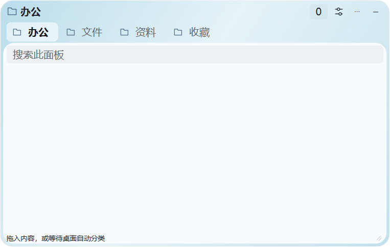
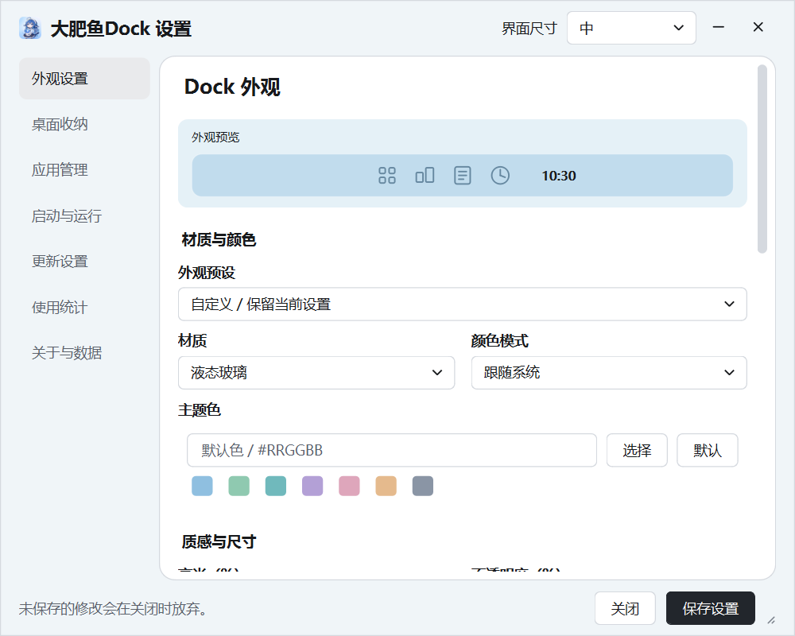

# 大肥鱼Dock · BigFishDockpro

一款面向 Windows 的桌面整理与美化工具，把常用应用、桌面文件、便签、时钟和日历放在随手可用的位置。

**玻璃质感 · 应用快捷启动 · 桌面分类收纳 · 便签与待办 · 时钟与日历**

[项目主页](https://github.com/HuoXiaolin/BigFishDockpro) · [版本记录](CHANGELOG.md) · [使用说明](使用说明.md)

## 功能特色

### Dock：常用应用，随手启动

- 支持拖入应用与快捷方式，也可批量添加、批量移除。
- 应用管理支持搜索、多选，区分已固定应用、Windows 工具和正在运行的软件。
- 可修改入口的名称、图标和链接，添加或移除分隔符；图标较多时支持翻页。
- 提供悬停放大、图标倒影、玻璃材质、外观预设、七种推荐主题色及全透明效果。
- 可显示时间日期，通过可翻页、可排序的九宫格快速切换外观、图标大小及便签/时钟/日历等组件开关，点击＋添加应用；各扩展均可关闭。 [效果与使用说明](docs/Dock快捷设置与倒影.md)

### 桌面收纳：分类清楚，分组合并

- 按应用、文件夹、文档、图片、影音等类型自动分类，也可手动拖入和设置文件格式规则。
- 支持多个独立面板、多个合并组，通过顶部分类栏切换页面，栏目可拖动排序。
- 支持图片缩略图、小图标、大图标和列表视图，以及搜索、文件名或修改时间排序、项目置顶。
- 文件右键调用 Windows 原生菜单，支持复制、剪切、粘贴、删除和重命名等常用操作。
- 收纳保存文件引用，不因收纳或移除引用而搬动、删除原文件；同一文件可被多个面板引用。

### 卡片外观：展开自由，收起轻巧

- 提供玻璃、浅色渐变、纸卡等外观，支持透明度、模糊、高光、明暗模式和主题色调整；玻璃背景取自桌面壁纸，不采集前台应用画面。
- 桌面收纳面板共用外观设置；独立卡片可自由调整位置与大小，合并页面共用尺寸。
- 独立卡片、合并组和便签可分别选择方条、胶囊或圆球收起样式，并支持自动收起、锁定。
- 胶囊和圆球在标题栏水平中心收起，图标居中，悬停显示名称；拖动后仍能恢复展开尺寸。
- 桌面图标可选择同时显示或全部隐藏，支持按屏幕可用区域适配布局。

### 便签与待办：随手记录，自动保存

- 提供液态玻璃、经典纸张和极简纯色三种样式，以及多种便签配色。
- 支持双击修改标题、正文独立字号、文字格式、待办清单和搜索。
- 支持新建、隐藏、恢复最近删除及永久删除，内容自动保存到本机。

### 时钟与日历：时间之外，看见进度

- 提供现代数字、现代表盘、纵向时间、日历周览、时光进度和月历看板。
- 时钟可独立设置字体、字号、字重、配色、背景、布局与显示内容，并预览效果。
- 时光进度展示今日、本周、本月、本年进度与下班倒计时，支持上下班时间、跨夜班次和休息时段。
- 支持工作周、节假日与调休配置，内置 2026 年中国大陆节假日数据，可导入其他年度日历。
- 日历可独立显示为桌面卡片，支持农历、节日名称、已收录年度假期标记、切换月份和回到今天。

### 日常运行：按需开启，记住偏好

- 支持自启动、启动路径检测与修复、延迟启动、游戏模式、全屏检测和托盘图标隐藏。
- 支持精简模式及关闭设置一分钟后自动进入，保持组件外观和展开状态，减少后台轮询并释放闲置缓存。
- 保存组件显隐、位置和运行偏好，支持配置导入与导出。
- 设置内可查看本机使用统计，包括启动次数、运行时长与功能使用频率，并可重置统计。
- 可启用屏幕圆角美化，Dock、卡片、便签、时钟和日历按需使用。

## 效果预览

截图使用演示内容或测试图标，玻璃效果会随桌面背景变化。

### Dock

| 浅色玻璃 | 全透明 |
| :---: | :---: |
|  |  |

### 桌面收纳

### 便签

| 液态玻璃 | 经典纸张 | 极简纯色 |
| :---: | :---: | :---: |
|  |  |  |

### 时钟

### 设置界面

浅色分组布局，相关控件并排；支持界面尺寸适配与精确数值调整。[设置说明](docs/轻透分组设置.md)

## 支持与赞助

感谢您使用 **大肥鱼Dock**！如果它让您的桌面更整洁、日常使用更顺手，欢迎随心赞助，请作者喝杯咖啡。

您的支持将用于持续维护、功能完善，以及补贴开发过程中的 **AI Token 和工具开销**，也是继续更新的一份动力。赞助完全自愿，欢迎同样通过问题反馈、功能建议或分享项目支持开发。

| 支付宝 | 微信支付 |
| :---: | :---: |
|  |  |

## 开始使用

支持 **Windows 10 / 11 x64**，无需另行安装 Python。

- **免安装版**：运行 `BigFishDockpro.exe`。
- **安装版**：运行 `BigFishDockpro-Setup-x64.exe`，按提示完成安装。
- 首次运行默认开启 Dock，桌面收纳卡片关闭；右键 Dock 可进入设置和应用批量管理。
- 需要桌面卡片、便签、时钟或日历时，在设置或对应菜单中开启。
- 个人配置保存在 `%APPDATA%/BigFishDock`；更换电脑或备份前，可在设置中导出配置。导出文件可能包含个人路径和便签内容，请妥善保管。

## 更多说明

[桌面收纳](docs/桌面收纳面板.md) · [便签卡片](docs/便签卡片.md) · [时钟与工作进度](docs/时钟设计与工作进度.md) · [尺寸与显示适配](docs/卡片尺寸与界面适配.md) · [运行与更新](docs/运行模式与更新.md)

开发与构建请参阅 [项目说明](docs/项目说明.md) 和 [源码结构](docs/源码结构.md)；历史改动见 [更新日志](CHANGELOG.md) 与 [历史记录](CHANGELOG_HISTORY.md)。

## 来源与许可

本项目基于 [WKaleXD/iOS-style-Dock](https://github.com/WKaleXD/iOS-style-Dock) 开发，维护作者为 HuoXiaolin。感谢原项目及相关开源工具的贡献。

基础项目的 MIT 许可与版权声明保留于 [LICENSE](LICENSE)。随 GPL PyQt5 分发的组合二进制遵循 GPLv3，第三方许可及设计参考见 [第三方说明](licenses/THIRD-PARTY-NOTICES.md) 与 [设计参考](docs/design-references.md)。
