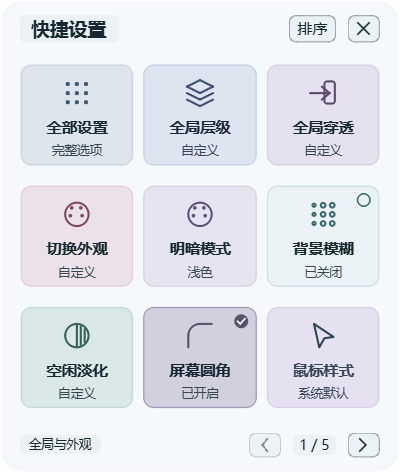
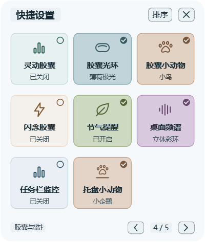

# Dock 快捷设置与倒影

Dock 新增图标倒影、时间日期、九宫格和＋添加入口，默认开启。在「设置 → Dock 外观 → Dock 扩展」分别关闭。

快捷设置每页最多九个按钮。鼠标停在面板或按钮上，向下滚轮进入下一页，向上返回；也可点击底部箭头。

默认分为「全局与外观」「Dock 与系统面板」「桌面卡片」「胶囊与监控」「入口与整理」五页，页脚显示当前分组。旧版默认排列自动升级，已手动排列的按钮保留相对顺序，新增按钮会放到相关功能旁。排序时点击「重置」可恢复分组。

首页的「全局层级」循环切换置顶、置底和自定义，「全局穿透」循环切换穿透、不穿透和自定义。回到自定义时，各组件恢复各自保存的选择。

「空闲淡化」依次切换「自定义 → 全部开启 → 全部关闭」。默认使用自定义，各组件的开关初始均为关闭。可在对应组件的设置或右键菜单中选择，便签和桌面卡片可逐张设置。开启后空闲 6 秒开始淡化，交互时恢复。淡化程度在「全部设置 → Dock 外观 → 桌面组件空闲淡化」调整，默认 50%，范围 0% 至 95%。任务栏内的组件保持原亮度。

「胶囊小动物」和「托盘小动物」分别轮换小猫、小狗、小兔、小鸟和小企鹅。「胶囊光环」轮换原版彩虹、六套炫彩配色和单色，「桌面频谱」轮换八种频谱形态。每项的最后两档是「自定义」和「已关闭」。自定义可恢复各自的形象、光环配色或频谱形态，动物的监测指标和速度可继续在详细设置里调整。

右键 Dock 图标可打开、编辑或移除该入口，右键文件夹可打开、重命名或解散。右键 Dock 空白处可进入应用管理、调整布局、打开设置、隐藏或退出 Dock。桌面组件的管理入口在托盘右键菜单。

「布局方案」可恢复胶囊和托盘小动物各自的开关与监测指标、农历卡片、节气提醒、水印、每日图片和系统面板选择。保存新方案也会记录分离卡片的位置。Dock 时间和日期根据所在位置的壁纸选用白字或黑字。

点击右上角「排序」，拖动按钮到目标位置即可交换；拖到翻页按钮并停留可跨页，也可右键选择移到上一页或下一页。「完成」退出排序，「重置」恢复默认顺序。顺序立即保存，保存失败时保留原排列。排序期间点击按钮不会误开关组件。

「切换外观」与主设置的「整体外观」共用九套主题，Dock、桌面卡片、便签、时钟和日历一起切换。最后三套依次是曜石铜边、青瓷釉面和落霞丝绒，再选「自定义」可恢复各组件之前的外观。图标大小和停靠位置各自保存自定义值，重新打开应用后仍可恢复。选择新的自定义值时，会替换该项的旧记录。

Dock 的「轻透液态」预设现为高光36%、不透明度0%，其他选项保持该预设原有设置。已有自定义配置保留，可重新选择此预设应用。开启倒影时，图标底部到 Dock 底边的整段距离减半；图标尺寸保持不变。

＋入口仍调用已有多文件添加界面。

倒影在当前页图标加载时预合成，使用单张「图标＋倒影」代替原图绘制。动画帧不翻转图像、不生成渐变、不创建倒影缓存，也不增加每个图标的贴图调用次数。合成贴图预算为2 MiB，只保留当前页；贴图大小会按图标数量调整，关闭倒影会释放这些贴图。贴图绘制仍需要处理更多像素，不能把“不增加调用次数”理解为绝对零 CPU/GPU 成本。

时间按分钟刷新，隐藏 Dock 或关闭时间后停止时钟定时器。悬停动画按需运行，鼠标离开且动画结束后停止计时。

保存设置按实际变化更新对应模块；同一全局主题不反复应用，不因修改更新设置而重载全部应用图标、卡片与便签。没有改动时不重复保存。隔离样例的内存与耗时记录位于项目 artifacts，不代表所有电脑或真实桌面场景的性能验收。
