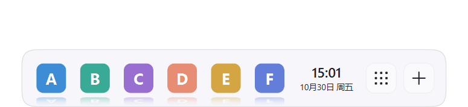
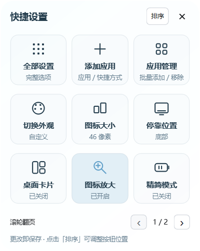
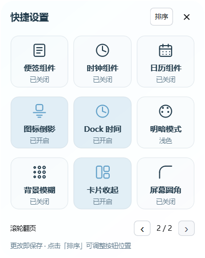

# Dock 快捷设置与倒影

Dock 新增图标倒影、时间日期、九宫格和＋添加入口，默认开启。在「设置 → 外观设置 → Dock 扩展」分别关闭。

快捷设置共两页，每页九个按钮。鼠标停在面板或按钮上，向下滚轮进入下一页，向上返回；也可点击底部箭头。

第一页包含全部设置、添加应用、应用管理、切换外观、图标大小、停靠位置、桌面卡片、图标放大和精简模式。第二页提供便签、时钟、日历组件开关，以及图标倒影、Dock 时间、明暗模式、背景模糊、卡片收起、屏幕圆角。组件开关沿用各自已保存的外观和位置；没有便签时首次开启会新建一张。

点击右上角「排序」，拖动按钮到目标位置即可交换；拖到翻页按钮并停留可跨页，也可右键选择移到上一页或下一页。「完成」退出排序，「重置」恢复默认顺序。顺序立即保存，保存失败时保留原排列。排序期间点击按钮不会误开关组件。

外观、图标大小和停靠位置的循环包含自定义状态。离开自定义时保存该项值，完整循环后返回；配置重载及重启后仍保留。自定义停靠保留距底部数值，不会改为默认距离；新的手动自定义会替换旧记录，其他设置不回滚。旧版已覆盖且未保留的自定义值无法自动找回，先在完整设置中重新保存一次即可。

Dock 的「轻透液态」预设现为高光36%、不透明度0%，其他选项保持该预设原有设置。已有自定义配置保留，可重新选择此预设应用。开启倒影时，图标底部到 Dock 底边的整段距离减半；图标尺寸保持不变。

＋入口仍调用已有多文件添加界面。

倒影在当前页图标加载时预合成，使用单张「图标＋倒影」代替原图绘制。动画帧不翻转图像、不生成渐变、不创建倒影缓存，也不增加每个图标的贴图调用次数。合成贴图预算为2 MiB，只保留当前页；贴图大小会按图标数量调整，关闭倒影会释放这些贴图。贴图绘制仍需要处理更多像素，不能把“不增加调用次数”理解为绝对零 CPU/GPU 成本。

时间按分钟刷新，隐藏 Dock 或关闭时间后停止时钟定时器。精简模式保留按需悬停动画，停止后台扫描和自动玻璃刷新；鼠标离开且动画结束后停止动画定时器。

保存设置按实际变化更新对应模块；同一全局主题不反复应用，不因修改更新设置而重载全部应用图标、卡片与便签。没有改动时不重复保存。隔离样例的内存与耗时记录位于项目 artifacts，不代表所有电脑或真实桌面场景的性能验收。
