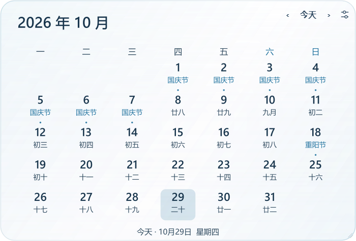
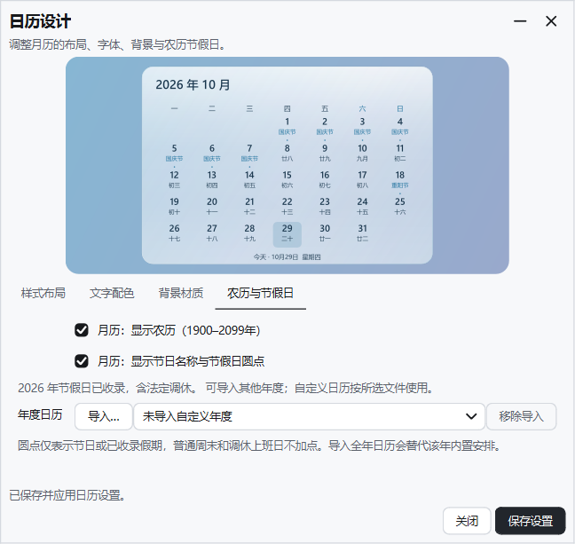

# 时钟设计与工作进度

## 样式与视觉

六种时钟样式（现代数字、现代表盘、纵向时间、日历周览、时光进度、月历看板）和独立月历使用同一套文字、强调色、留白和圆角规则。时光进度保留时间圆环，右侧突出下班倒计时，底部使用周/月/年指标卡；小尺寸优先显示圆环和下班状态。

设置分为样式布局、文字配色、背景材质、工作时间。可选择浅色主题、透明或深色主题，选择系统字体，分别调整时间/辅助字号、字重、字距、颜色、透明度、阴影、自动对比度、圆环与条形粗细、窗口尺寸和留白。进度指标可按需关闭。与当前样式不相关的控件自动禁用。

## 下班进度

默认班次为 09:00—18:00，可修改为自己的时间。下班早于上班时间表示跨夜班次，按上班当天判断工作日。状态包括尚未上班、工作中、班内休息、已下班、今天休息。可选扣除班内休息时段；剩余时间始终表示距离实际下班的钟表时间。

日历可选中国大陆法定节假日/调休、自定义工作周或每天上班。额外上班日/休息日优先于年度日历，年度调休优先于普通周末，重叠的自定义日期会被拒绝。放假当天凌晨仍可能属于前一天的跨夜班次。

内置 2026 年国务院节假日与调休安排，离线可用：
- 原始通知：https://www.gov.cn/zhengce/content/202511/content_7047090.htm
- 核对文本：https://www.beijing.gov.cn/cs/gncs/zcwj/202603/t20260327_4568275.html

未收录年份不会猜测放假日期，界面明确提示按工作周计算；可导入年度日历。导入同年日历会完整替代该年的内置安排，因此应提供全年数据；个人请假/加班优先使用额外日期。导入仅修改待保存的设置，可移除导入以恢复内置安排或工作周规则。

年度日历文件结构（以下为空白格式，具体日期请按可靠通知填写）：

```json
{
  "year": 2027,
  "source": "自己的全年工作日历",
  "holidays": {},
  "workdays": []
}
```

`holidays` 是 YYYY-MM-DD 到名称的对应表，`workdays` 是调休上班日期数组。每个日期必须属于所选年份，不允许放假与上班日期重复。内置数据随软件发布；不静默联网抓取，也不自动补写未收录年份。

时钟与独立日历的设置分别保存；整份配置导入导出包含班次、自定义日期和已导入的年度数据。分钟级定时器继续复用，隐藏时停止更新，没有额外高频后台任务。实时玻璃已移除，本轮未恢复。

## 农历与节假日

独立日历、时钟月历样式及月历背面支持离线农历、节日名称与圆点标记，可在各自设置中开关。农历支持1900–2099年，超出范围不显示农历。圆点表示节日或已收录年度假期，普通周末、自定义休息日和调休上班日不加圆点。未收录年度只显示可确定的节日与农历，不推测放假和调休安排；可导入年度日历补充。

农历转换采用[lunardate 0.3.0](https://pypi.org/project/lunardate/0.3.0/)，春节、端午、中秋样例日期按[香港天文台2026年公农历对照表](https://www.hko.gov.hk/en/gts/time/calendar/pdf/files/2026e.pdf)核对。运行时无需联网查询。第三方版权和许可见licenses目录。




