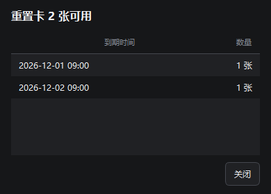

# 资源胶囊与媒体

资源胶囊沿用大肥鱼Dock 的主题、字体和材质。右键资源胶囊打开设置，桌面和任务栏可分别启用。

## 流量统计

开启「流量统计」后，展开「流量」页显示今日、本月、本年的下载、上传和合计；「历史记录」按日、月或年汇总。收起读数和任务栏也可选择流量。

数据保存为用户配置目录中的 `network-traffic.json`，以本机日历区分日期。优先统计正在工作的物理网卡，避免把隧道和物理出口重复累计；没有物理接口时才采用其他有效接口。新接口、计数器归零、暂停或重启都建立新的基线。采样跨越午夜时按间隔时长分摊，异常长的休眠间隔不补算。每 15 秒及正常停用时保存，异常断电可能丢失最后一小段尚未落盘的数据。

统计仅覆盖显示端运行且统计启用的时间，不代表运营商计费流量，也不回填程序关闭或组件暂停期间的数据。仅使用任务栏时，需要在任务栏项目中勾选「流量统计」。桌面/任务栏同时显示时使用同一采样器，避免重复累计。损坏的记录文件会保留，并提示读取失败。

## 指标、字号与阈值

- CPU：使用率、温度、频率、功耗、电压、风扇、水泵。
- GPU：使用率、温度、频率、功耗、风扇、显存占用。
- 主机：内存、实时 FPS、磁盘温度、主板温度、主板风扇和机箱温度。另有网速、流量、进程排行与蓝牙电量。

温度和频率等读数取决于驱动、固件或本机已有的 LibreHardwareMonitor / OpenHardwareMonitor 数据服务。缺少读数时默认隐藏，关闭「隐藏未提供读数的传感器」后可查看缺失项。CPU 的 ACPI 回退读数标为「系统温区」。同类存在多个有效读数时显示最高值。

在「资源与阈值」可分别启用主板、CPU 和 GPU 风扇。展开资源卡片、收起显示和任务栏监控均可选择相应项目。Dock 读取 Windows 转速计、显卡驱动及现有监控工具的实测 RPM。AIDA64 已运行并启用「将传感器值写入注册表」时，也会读取它导出的风扇转速。风扇缺少有效读数时始终隐藏，设备明确报告停转时显示 0 RPM。 [Windows 转速计](https://learn.microsoft.com/en-us/windows/win32/cimwin32prov/cim-tachometer) · [NVIDIA NVAPI](https://docs.nvidia.com/nvapi/group__gpucooler.html) · [AIDA64 数据导出](https://www.aida64.com/user-manual/hardware-monitoring/external-applications)

任务栏字号范围为 2–24 逻辑像素，随 DPI 缩放；缩小后文字、间距、封面、控制按钮与频谱同步收紧。高度不够两行时切换为单行，宽度不足时分页；字号本身超出任务栏高度时只压到可容纳的大小，保存的偏好不变。

横向任务栏默认可显示音乐，位于资源读数左侧：封面、短曲名、上一首/播放暂停/下一首、真实声音律动，底部细线显示进度并支持点击跳转（播放器须支持）。音乐和资源文字按实际内容高度上下居中；任务栏较窄时先缩减曲名、律动和切歌按钮，保留可用的播放控制并对读数分页。没有媒体时自动收回音乐占用的宽度。宽度申请仅在检测到的任务栏空位内，不覆盖系统按钮。竖向任务栏使用原有资源读数布局。

「任务栏监控 → 任务栏位置」可选靠左、居中、靠右，右键菜单也可切换。监控条按 Windows 11 开始菜单、应用按钮和系统托盘的实际边界选择空位。居中位置被占用时，使用离中点最近且能容纳组件的空位。

「胶囊行为 → 收起时固定到任务栏」为资源胶囊单独设置位置，可选靠左、居中、靠右或记住拖放位置。也可直接把胶囊拖到任务栏。胶囊拖动时避开已占用的任务栏区域和监控条，两者各自保存位置。点击固定的胶囊会朝屏幕内侧展开，关闭固定后回到原桌面位置。没有可用空位时，胶囊暂留原处。

「显示层级」默认置底，读数贴着系统任务栏的层级显示。置顶在浏览器或无边框窗口全屏时沿用已验证的位置，仍保持采样。独占全屏取决于应用的显示模式，普通 Windows 窗口无法保证覆盖。「暂停桌面组件」可手动隐藏任务栏监控。临时探测失败时沿用已验证的位置，确认空位变化后再移动。

「胶囊行为」和「任务栏监控」分别提供「鼠标穿透」，默认关闭。开启后，鼠标可直接操作组件下方的窗口。可从托盘右键「资源胶囊」关闭对应的穿透开关。

播放按钮在按下时记录按钮范围及播放器，松手前暂缓任务栏位置变动；小幅鼠标移动不会变成拖出操作。首次点击不会激活 Dock 窗口或被激活过程吞掉。播放器在这期间消失时不把命令转给另一个播放器。

「任务栏监控 → 音乐多彩样式」或右键菜单可独立控制频谱和进度线的彩色显示，关闭后使用系统字体颜色；不影响资源阈值开关。

「任务栏监控 → 横向任务栏显示音乐」或任务栏监控右键菜单可关闭音乐。该选项独立于桌面音乐开关；仅任务栏使用时仍复用同一个媒体组件，不额外启动播放器或第二个组件进程。没有任何 AI/音乐使用需求后释放整个组件。首次使用缺少 .NET 时，在资源设置中按提示安装运行库。

任务栏音乐的封面图标、曲名、播放按钮、声音律动/频谱、进度细线可分别勾选；也可在右键「音乐组件」中切换。只选频谱或只选图标时不占用其他组件的空位；不需要资源读数时可同时取消任务栏监控项目，保留纯音乐组件。所有音乐组件均取消时不启动音乐连接；没有任何可见频谱时停止音频采样。显示模式「声音流动 / 频谱」在「AI 与音乐 → 音乐律动」选择。

阈值按配置上限计算：低于 60% 绿色，60% 至不足 80% 黄色，80% 起红色。占用类上限为 100%，温度默认上限 100°C；「阈值上限」可修改温度上限，并为功耗、频率、电压、风扇设定合适的上限。未设置上限的读数保留主题色。胶囊和任务栏各有独立的变色开关；任务栏默认跟随系统字体颜色，可在「任务栏监控 → 文字阈值变色」或任务栏右键菜单开启数值变色。标签、无读数和未配置上限的项目继续跟随系统明暗配色，绿黄红也按系统明暗选择清晰的色调。

资源读数在绿、黄、红各档内随占用升高加深颜色。收起天气温度和空气质量在对应档内渐变，电脑和蓝牙电量越低，低电量红色越深。浅色和深色界面分别使用适合各自背景的配色。

## 收起显示与光环

「收起显示」按功能分组。开启电脑状态后，可在该组分别勾选电池、网卡名称、音量和亮度。「专注与日程」可勾选番茄钟、喝水进度和下一项日程，默认关闭这些新常驻项。在「读数排序」把常看的项目移到前面，空间不足时其余项目分页。圆球用图标提示到期提醒。胶囊默认 500 × 35 逻辑像素。启用自动宽度时，宽度按内容缩减。

电池、网卡、音量、亮度与蓝牙选中后用独立图标靠右显示，点击可打开资源页。日期与时间可选时分、时分秒、日期或日期与时间两行。番茄钟、喝水进度和日程的常驻内容与到期提醒共用徽标。AI 额度显示供应商图标和数值，音乐显示播放状态和频谱或曲名。可在「尺寸与分页」统一调整这些徽标的高度，默认 20 像素，支持 16 到 40 像素。实际高度以胶囊可用空间为限。

天气用彩色图标表示晴雨等状态。温度默认低于 0℃ 为深蓝，0℃ 至不足 16℃ 为浅蓝，16℃ 至 26℃ 为绿，超过 26℃ 至 30℃ 为黄，超过 30℃ 为红。四个分界值可在「资源与阈值 → 收起天气温度颜色」调整。

宽胶囊并排显示 AI 额度、音乐、资源和时间，补充读数分页。窄尺寸自动采用双行小字号，放得下的常驻项保持在左侧，其余项目与补充内容轮播。时间、表情和蓝牙环按剩余空间显示。AI、音乐和天气也可常驻，同一位置的多个城市或提供商轮换显示。滚轮手动翻页，自动翻页每 6 秒进行一次，悬停时暂停。剩余额度降至 40% 或 20% 时，展开页标题栏提示 5 秒。

自动翻页和向下滚轮切到下一组时，内容向上滚出，新读数从下方进入。向上滚轮切回上一组时反向过渡。过渡约 0.24 秒，随整体动画开关启停。

胶囊各栏共用展开宽高，默认 500 × 280 逻辑像素。资源、AI、流量、天气、番茄钟、日程和原生卡片的网格按窗口宽度自动排布。360 逻辑像素及以下为单列，超过 360 为双列。可拖动四边或四角调整大小，松手保存。收起最小 96 × 28，展开最小 260 × 180。小窗口可横向切换顶部栏目，内容在页内滚动。

展开后可拖动顶部栏目排序，也可把栏目拖出胶囊独立显示。把桌面组件的标题栏或本体拖回胶囊可收回，放到顶部栏目间可同时调整顺序。便签和原生卡片以整个栏目切换位置。「组件布局」按监控与媒体、日常内容、桌面组件分组，可集中设置。独立卡片保存各自的位置和尺寸，胶囊关闭后仍可使用。

「胶囊行为 → 展开后默认页面」或胶囊右键菜单可选择已启用的栏目，例如天气。所选栏目关闭时进入资源页。默认在同一次运行中沿用上次查看的页面。

右键胶囊可开关「屏幕边缘吸附」。「资源胶囊设置 → 表情与吸附」还可单独开关「相邻卡片吸附」。两项默认开启，共用主设置「桌面收纳」里的卡片吸附总开关和距离。胶囊贴边后，拖动本体离开边缘会拉出液桥。启用整体动画和液态拉伸时会显示液桥与断开的水滴。

「资源胶囊设置 → 材质与配色」可开关彩色流动光环，也可调节流动速度。慢速每圈 12 秒，中速每圈 8 秒，快速每圈 4 秒。默认中速，切换速度时从当前颜色位置继续流动。

同一页的「卡底透底」可在 0%–100% 之间调节，默认 20%，保存后应用到各页卡片和收入胶囊的组件。天气卡片保留晴雨、空气质量和日照时段的配色。

关闭整体动画时，已开启的光环保留为静态彩色边缘。胶囊的置顶、置底、拖动、自动收起及独立背景设置继续有效。

开启「鼠标离开后收起」时，指针在胶囊外停留达到设定时间后收起。拖动、缩放或打开菜单时暂停计时，交互结束后重新计时。

## AI 额度与用量

在「AI 与音乐」开启 AI 并选择最多 7 个工具。自动读取已登录工具自己的凭据及本地用量记录；支持 Claude、Codex、Cursor、Antigravity、ZCode、DeepSeek Harness、Kimi、OpenCode、Pi、Grok Bot。没有登录或接口未提供配额时显示真实状态；有本地用量但没有线上额度时仍保留用量。每分钟刷新，可手动刷新。

展开「AI」页，在紧凑卡片中查看套餐、剩余额度进度条和恢复时间，下方可查看用量统计。点击工具行或「模型明细」，可按工具和日期区间查看模型数据。费用优先采用记录金额，其次采用模型单价估算。金额以 USD 显示，含估算和未定价条数单列，账户余额按原币种显示。

Codex 的同一额度卡片下方显示重置卡图标、可用数量和最近到期时间。点击图标或文字，可查看按到期时间归并的数量明细；时间转换为本机时区。这里仅查询信息，不会自动消耗重置卡。它随线上额度约每分钟刷新，与用量日期筛选无关。账户没有卡片时显示 0 张；未登录、接口未提供或暂时无法读取时单独显示对应状态，不能将其视为 0 张。



「AI」页将额度与统计合并，支持今天、昨天、7 天、30 天、全部及工具筛选。概览显示 Token、计量记录数、费用、缓存命中率，下面是费用环图、可切换 Token/费用/记录的趋势图及工具分布；点击工具进入同一时间范围的模型明细。今天/昨天按小时、较长区间按日汇总，长历史最多合并为 45 组，合计不丢失。缓存命中率为读取缓存 Token / 总输入 Token（含缓存读写）。记录数来自计量事件，不等同于 HTTP 请求数；上游未提供失败请求数时不显示虚构值。

默认读取最近 30 天。「全部」首次点击后才加载 Claude/Codex/Pi 可读的本地完整历史；其他来源仍受接口返回范围限制，并不保证有全部历史。后续增量刷新复用读取缓存。未连接、未知字段、未定价或未读完整的状态保留，不按零冒充。

在「AI 与音乐」开启「独立 AI 用量托盘图标」，并在「托盘显示」选择模式。自动模式为每个工具选当前最短的额度周期，同一周期优先显示剩余较少的读数，最多显示三环。实时读数排在缓存之前，缓存额度环用灰色，悬停标注「上次读数」。只有余额读数时，自动模式显示余额。固定模式可选择一个工具和具体额度或余额。

圆环的尺寸、线宽和进度开口与外设电量托盘一致，AI 最外环右下保留 Q 形尾巴。剩余 70% 起为绿色，40% 至不足 70% 为黄色，高于 10% 且低于 40% 为橙色，10% 及以下为红色。悬停显示套餐、周期、剩余和恢复时间，点击把外圈对应的额度卡放在首位，仍可浏览所有工具。右键可刷新、进入设置或关闭图标。仅开启 AI 托盘时，独立采集 AI 用量。暂停桌面组件会隐藏图标。

每档颜色会随着剩余额度减少而加深，例如 10% 开始使用较浅的红色，越接近 0% 红色越深。

登录凭据只在独立组件内存中读取并发给对应服务，不通过 UI 管道输出；不会修改、续期或注销登录。输出只包含配额、按时/日/模型聚合的 Token 和费用，不包含会话正文或认证信息。配额与单价缓存写入本应用用户目录的 `deck-data`。本次集成提供自动登录来源，不提供手动 API Key、自定义脚本提供商或 WSL 扫描界面。

### 自定义用量接口

在「资源胶囊设置 → AI 与音乐 → 自定义用量接口」选择「自动识别」，输入平时使用的 API 地址和 Token。OpenCode Go 和 Command Code 可识别常用推理地址，也可以直接选择对应预设。Command Code 读取 CLI 账单接口提供的用量窗口、月度余额和费用，OpenCode Go 读取 5 小时、周和月的额度。 [OpenCode Go](https://opencode.ai/docs/console/go/) · [Command Code 套餐额度](https://commandcode.ai/docs/resources/pricing-limits)

通用网关会尝试 API 同域名下的 `usage` 和兼容的账单读取路径。可选择「指定用量地址」直接填写供应商提供的完整地址。只使用只读 GET 请求，Token 由 Windows 加密保存在本机。网关账单使用供应商原始额度单位，只有接口返回 USD 费用时才计入 USD 统计。使用兼容接口的自建网关可以返回下列结构，字段按实际可提供的数据填写。

```json
{
  "quotas": {
    "fiveHour": {"usedPercent": 25, "resetAt": "2026-11-10T15:00:00+08:00"},
    "weekly": {"used": 2, "limit": 10},
    "monthly": {"remainingPercent": 84}
  },
  "periods": {
    "today": {"tokens": 1200, "requests": 3, "cost_usd": 0.01}
  }
}
```

## 音乐

开启音乐后自动连接 Windows 系统媒体会话，并复用 BrimDeck 的网易云、QQ 音乐、酷狗兼容读取。显示封面、歌名、歌手、进度、当前歌词，支持多播放器选择和固定。播放/暂停、切歌、进度、随机和循环按钮按播放器报告的能力启用。

直播等无进度的系统媒体可通过播放按钮暂停声音。匹配到播放应用的唯一活动音频会话时，通过 Windows 音频会话保持静音，再点一次恢复声音。共享同一个会话的浏览器标签会一起静音。

收起时可选择声音律动、歌名或当前歌词；律动支持声音流动与频谱，来自实际音频采样，不使用随机动画冒充声音。只有显示律动的胶囊或音乐页才进行音频采样，其他页面保留媒体信息和播放控制。歌词开关决定是否联网匹配，关闭后停止歌词查找。歌词与封面服务按歌曲元数据查询，不上传聊天记录。

本应用不会自动修改第三方播放器文件或重启播放器来获取额外控制能力；未开放控制接口的播放器可能只能显示信息。没有媒体时显示空状态。关闭音乐后释放媒体会话与音频采样；桌面 AI、独立 AI 托盘和音乐均无使用需求时结束整个组件进程。

## 构建与来源

参考 [BrimDeck](https://github.com/MoFeng2223/BrimDeck) 的功能和公开实现，固定提交见 `references/BrimDeck-PIN.json`。`tools/DeckBridge` 只链接其核心数据模块和所需媒体连接源文件，Qt 前端与窗口主题由本应用实现；不启动 BrimDeck 的界面。

构建 AI/音乐组件需要 .NET 10 SDK：`python tools/prepare_deck.py`。组件以 framework-dependent 单文件发布，复用已安装的 .NET 10 Desktop Runtime（x64），运行库不再随包内置。默认兼容 10.0 系列补丁版本；Windows 自带的 .NET Framework 4.x 不能替代它。未检测到时，AI/音乐页给出内联提示，可在设置打开微软官方下载页，不自动安装；Dock、卡片及硬件监控不受影响。安装后点「刷新」重新检测。共享和内置运行库主要影响发行包大小，不承诺按相同比例降低运行内存。

若 Windows TLS 环境无法连接 NuGet，可用 `python tools/fetch_deck_dependencies.py` 通过验证 HTTPS 证书的 Python 下载固定依赖到本地源，再构建。完整构建入口仍为 `build.ps1`。资源展开页按需创建，统计结果在来源、日期或筛选变化时才重新汇总；封面传给前端前限制为 256 像素。

统计与独立托盘的设计参考 [OpenQuota](https://github.com/deviffyy/OpenQuota)，按本应用主题重绘，不包含其 Tauri 运行时或网关后端。固定提交、设计用途和 MIT 许可已列在 README 项目参考中。

许可证见 `licenses/BrimDeck-Apache-2.0.txt`、`licenses/BrimDeck-ThirdPartyNotices.txt` 及 `licenses/deck`。源码导出保留上游源码和声明，排除 `.git`、`bin`、`obj` 与编译缓存。

## 液态与天气

「表情与吸附」分别提供吸附、液态、表情显示和表情互动开关。「材质与配色」可调玻璃材质、透明度和主题色。拖拽吸附与液态效果默认开启。拖动胶囊本体时，从屏幕边缘拉出短液桥，超过距离后断开并留下回缩水滴。松手吸附最近的工作区边缘，避开任务栏，折叠或展开仍保持贴边。拖动边缘和四角可调整尺寸。

资源胶囊默认显示小表情，收起和展开时都位于左侧。旧配置缺少表情开关时采用开启默认值。可选择靠近随机变化或固定表情，大小为 60–130%。互动开关独立控制视线跟随、眨眼、困倦和按压形变。展开方式可选「鼠标移入展开」或「仅点击展开」，与离开后自动收起分开设置。

胶囊的玻璃背景在收起和展开时都使用所在屏幕的桌面壁纸。切换壁纸后自动刷新。胶囊可见时定期检查壁纸变化，沿用缓存绘制动画。

天气默认关闭，可在「天气」启用。预设天津、乌鲁木齐、沈阳，城市列表最多 6 个。使用 Open-Meteo 获取昨天和今天起七天的天气。默认显示昨天、今天、明天，可切换范围。卡片按晴、多云、阴、雨、雪、雾、雷雨绘制对应矢量背景。采用北京时间，每 15 分钟更新，也可手动刷新。联网失败时保留旧值并标注「待更新」。天气来源在「备注」中查看。

本次明确不加入资讯聚合、股票、行情或分时功能。液态交互参考 Wisland，固定提交与 MIT 许可见 README；没有引入它的 PySide6 运行库或 ASR 模型。原有 AI/音乐仍共用 BigFishDeckBridge，新增交互和天气提醒不增加辅助进程。

## 本轮紧凑显示与内存预算

任务栏取消固定资源区宽度，按实际字体和读数紧凑排列；任务栏基础文字跟随 Windows 系统明暗配色，主题变化立即更新，数值阈值变色可独立开关。AI 额度与统计共用一个页面，单一工具隐藏筛选器，左下角说明默认折叠到「备注」。托盘额度图标的线条加粗，辅助进程也使用本应用图标。

`tools/DeckBridge/Core` 使用 32 KiB 输入缓冲跳过非计量字段，单条计量元数据最多 256 KiB。近期与全部历史共用缓存，托管堆预算为 16 MiB。1.2.0 由 Windows 将辅助进程总工作集限制为 47 MiB，包含驻留的共享页，避免用紧迫的私有提交上限拒绝 CLR 与驱动的原生分配。超过托管堆预算时保留上次读数并稍后重试。

桌面音乐频谱采集默认播放设备输出，支持炫彩与单色。天气页含逐小时、每日预报、空气质量、日出日落和月相。空气质量由 Open-Meteo 提供 CAMS 模型结果，AQI 使用美国口径。新闻订阅仅在打开胶囊新闻页时读取已填写的 RSS / Atom。每日图片在桌面单独开启，按需读取必应图片。

## 表情跟随与设置页内存

开启互动后，小表情支持鼠标跟随与按压。收起时先预留表情位置，再分配常驻读数。圆球、胶囊和展开状态均可跟随全屏光标，只有鼠标靠近时才会随机换表情。关闭互动或全局动效后显示静态表情，隐藏窗口后停止表情检测和绘制计时。

资源设置切换栏目时按需创建控件并保留编辑草稿，保存时提交实际改动。打开设置时继续保留表情跟随。Explorer 遮住任务栏监控条时会恢复监控条层级，其他可点击的置顶窗口与监控条重叠时，监控条会暂时让开。

## 电脑状态

资源页的「电脑状态」卡片共用现有资源采样。电池圆环显示剩余电量，充电时用绿色闪电。电池供电时，15% 及以下用红色，16% 至 35% 用黄色。网卡显示当前网络连接名称，Windows 无法提供网络名称时使用网卡名称。默认输出设备显示系统音量与静音状态。亮度优先读内置屏幕，再尝试主显示器的 DDC/CI。设备未提供的读数显示「—」。[Windows 电源状态](https://learn.microsoft.com/en-us/windows/win32/api/winbase/ns-winbase-system_power_status) · [Windows 网络名称](https://learn.microsoft.com/en-us/windows/win32/api/netlistmgr/nn-netlistmgr-inetwork) · [Windows 显示器亮度](https://learn.microsoft.com/en-us/windows/win32/wmicoreprov/wmimonitorbrightness) · [DDC/CI 亮度接口](https://learn.microsoft.com/en-us/windows/win32/api/highlevelmonitorconfigurationapi/nf-highlevelmonitorconfigurationapi-getmonitorbrightness)

蓝牙电量并入同一块卡片，设备名旁使用小圆环，低于 15% 显示红色。可手动刷新和多设备翻页。在「资源与阈值」分别开关电脑状态和蓝牙电量。

## 番茄钟与喝水

在胶囊的「番茄钟」页选择专注或休息，点击开始。支持暂停、继续、重置，到点后可手动开始下一轮。点「设置」可调整专注和休息分钟数。计时按到期时间计算，切换栏目、收起或重启后可继续查看。

喝水卡片与番茄钟使用相同布局。水滴进度环在左，饮水量、今日目标和百分比在右。喝水提醒初始关闭，开启后默认每 45 分钟提醒，每次记录 250 mL，今日目标 2 L。点「喝一口」记录，点「撤销」撤回上次记录，提醒时可选「稍后」。进度按本地日期累计。

收起时，珊瑚色番茄显示专注倒计时，绿色杯形图标显示休息，蓝色水滴显示待喝水。圆球用角标和色环表示提醒。点击提示打开「番茄钟」。可在「日程与提醒」开关整页及收起提醒，在「组件布局」调整顺序。

## 日程与收起提醒

「日程」左侧是月历，右侧依次显示提醒中、进行中、未开始和已结束的日程。同一状态按开始时间从早到晚排，状态变化时列表自动更新。倒数日列在日程之后。资源胶囊月历与桌面日历共享日期标记，灰色为本地、蓝色为钉钉、青绿色为飞书、橙色为腾讯会议、靛色为滴答清单、玫红为 NextTodo、紫色为倒数日。点「新增」填写标题、开始、结束和提前提醒分钟数。选择尚未结束的日程，可取消提醒或恢复已取消的提醒。同步日程的「提醒设置」显示来源提供的标题和日期，可调整提前提醒分钟数。

「资源胶囊设置 → 日程与提醒」可分别开关日程、番茄钟和喝水的收起提示。低电量提示在「收起显示」内设置，默认关闭，开启后在电池供电且电量降至 15% 及以下时显示红色提示。收起时到点提醒优先占用读数区域，日程徽标最多占胶囊宽度的 20%。长标题每滚完一圈会回到开头，停 5 秒后继续。点击提示打开对应栏目。圆球显示优先提醒的图标。

日程、专注结束、休息结束、喝水、低电量和 AI 额度各用一段约半秒的自然录音。「日程与提醒」中的「播放提示音」默认开启，可独立控制声音。关闭时停播并清空排队的提示音。多类提醒同时到达时依次播放，暂停桌面组件时静音。AI 额度首次读取时静音，之后跨入更低的额度档位时发声。[录音来源](../licenses/THIRD-PARTY-NOTICES.md#natural-reminder-sounds)

### 日程账号接入

「日程与提醒 → 日程与账号」显示本机账号、连接状态、上次同步时间和日程条数。点「编辑」可设置本机显示名称，点「重新授权」可再次扫码或更换令牌及服务器地址。点「移除」清除本机授权和同步记录。连接错误可换行查看，长消息支持滚动。

在「资源胶囊设置 → 日程与提醒 → 日程账号接入」选择来源。二维码显示在 Dock 设置里，也可打开官方授权页。钉钉和腾讯会议通过各自的官方组件直接扫码授权，免去手动在开放平台创建应用和填写 AppKey、密钥的步骤。

- 钉钉优先复用本机校验一致的官方组件。首次缺少该组件时，点击「下载组件并扫码」下载约 24 MB，窗口显示已下载大小和百分比。可取消或重试。用钉钉扫码、选择组织并确认。组织需允许 CLI 访问。 [钉钉官方授权](https://github.com/DingTalk-Real-AI/dingtalk-workspace-cli/blob/main/README_zh.md#开始使用)
- 飞书点击「扫码登录」。首次扫码后由飞书创建「大肥鱼 Dock 日程」授权应用，接着扫码确认日历读取权限。中途关闭窗口，下次可继续使用已创建的应用。后续凭证自动续期，重新授权时可复用应用。 [飞书官方扫码注册](https://github.com/larksuite/oapi-sdk-go/tree/v3_main/scene/registration) · [飞书日程视图](https://open.feishu.cn/document/uAjLw4CM/ukTMukTMukTM/reference/calendar-v4/calendar-event/instance_view)
- 腾讯会议首次按需下载约 14 MB 的官方 Windows 组件。扫描二维码打开腾讯会议官方授权页，按页面提示确认。Dock 读取该账号获准查看的待办和进行中会议。 [腾讯会议官方 CLI](https://cloud.tencent.com/document/product/1095/133827)
- 滴答清单在网页版头像菜单打开「设置 → 账户与安全 → API 口令」，创建并复制口令，粘贴到 Dock 后点「连接并同步」。[滴答清单 API 口令说明](https://help.dida365.com/articles/7464976698707017728)
- NextTodo 在「设置 → 令牌」生成只读令牌。连接本机版时，保持 NextTodo 运行，服务器地址填 `local`。连接自建版时，填写服务器地址。粘贴令牌后点「连接并同步」。Dock 以 `BigFishDockpro` 标识访问接口。若提示 Cloudflare 拦截，请联系服务器管理员检查防护规则。[NextTodo 令牌说明](https://juniexd.github.io/NextTodo/guide/agent) · [Cloudflare 1010 说明](https://developers.cloudflare.com/support/troubleshooting/http-status-codes/cloudflare-1xxx-errors/error-1010/)

设置会显示最近同步时间和日程条数，也可点「立即同步」。凭证和同步缓存使用当前 Windows 用户的加密存储。Dock 的设置导出只包含本地日程和手动导入记录。

启用日程页时，Dock 启动后和运行期间每 10 分钟同步。钉钉、飞书读取主日历，腾讯会议读取待办与进行中会议，滴答清单和 NextTodo 读取有日期的未完成待办。同步范围为过去一天至未来 14 天，每个来源最多缓存 256 条。待办只有日期时显示为全天，初始关闭提醒。改期、取消、完成或删除会更新本机提醒。在胶囊里选中同步日程可调整提前提醒分钟数。断网时使用最近一次成功的缓存，恢复网络后自动重试。授权失效后可重新扫码或更新令牌。

钉钉与飞书也可手动导入。断开后清除本机的同步记录，并重新显示该来源此前手动导入的记录。

## 表情角色包

在「资源胶囊设置 → 表情与吸附」、桌面收纳卡片的标题栏设置或「主设置 → 桌面收纳」点击「导入角色包」，选择本地 `manifest.json`，然后保存设置。三处共用角色库，资源胶囊和桌面收纳分别选择。「复制提示词」可获取完整制作要求。同一个 `id` 再次导入会更新角色，选择「内置表情」可切回默认形象。

```json
{
  "version": 1,
  "id": "whale-girl",
  "name": "鲸鱼女孩",
  "layers": {"back": "body.svg"},
  "anchors": {"left_eye": [39, 54], "right_eye": [61, 54], "mouth": [50, 69]},
  "ink": "#23344D"
}
```

- 清单和图层用 UTF-8，放在同一个文件夹。每包必须有 `back` 图层，可用 `"front": "front.svg"` 增加刘海或帽檐等前景。两个图层均使用透明背景，根元素的坐标系为 `viewBox="0 0 100 100"`。
- `anchors` 标记画面左眼、右眼和嘴的中心，坐标向右、向下增加。应用按这些位置绘制并驱动五官。制作 SVG 时把五官留空，`ink` 留空时跟随主题色。
- 支持路径、基本几何、分组、变换与图层内渐变。清单最多 8 KiB，每个 SVG 最多 64 KiB。SVG 使用矢量形状与元素属性配色，导入时校验图层。
- 导入后文件保存在本机角色库。换电脑时可重新导入原角色包。

## 余额与排序

DeepSeek 的账户余额、赠送余额和累计消费在详情中显示源数据的货币金额。托盘选中余额时，以透明底和 Windows 任务栏字色单行显示币种和整数部分，例如「¥20.12」显示为「¥20」。悬停可看完整金额。

收起页和任务栏设置分别提供读数排序和监控列排序。拖动、上移或下移后点「确定」，再保存资源设置。常驻项保持在收起内容前端，任务栏保持相关读数的上下两行组合。
